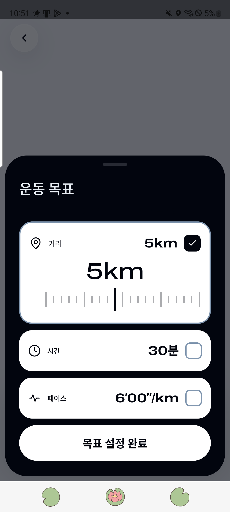
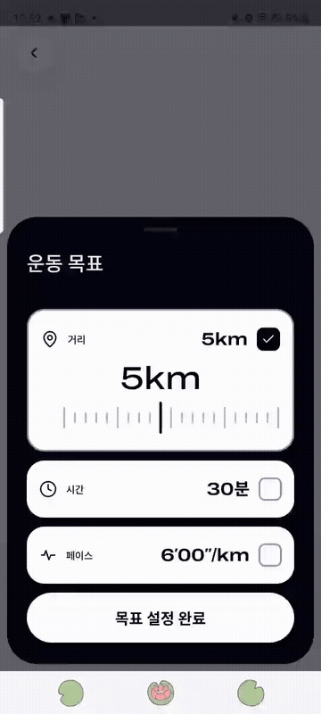

# RunWay

**달리기 전의 컨디션부터 마지막 기록까지, 한 번의 러닝을 이어 주는 모바일 러닝 서비스**

RunWay는 휴대폰과 Galaxy Watch에서 모은 운동 데이터를 바탕으로 오늘의 러닝을 준비하고, 달리는 동안 페이스를 확인하고, 끝난 뒤 기록을 돌아볼 수 있게 만든 팀 프로젝트입니다. 혼자 달릴 때는 목표와 코스를 정해 출발하고, 함께 달릴 때는 크루와 그룹런으로 연결됩니다.

## 앱 화면

운동을 시작하기 전에 거리·시간·페이스 중 원하는 기준을 고릅니다. 아래 화면과 GIF는 실제 Android 앱에서 촬영했습니다. 계정 정보나 위치가 드러나는 화면은 포함하지 않았습니다.

| 목표를 고르기 전 | 거리 목표 선택 | 목표 값 조절 |
| :---: | :---: | :---: |
|  |  |  |

## 달리기 흐름

### 출발 전

수면, 최근 운동량, 심박 등 연결된 건강 데이터를 운동 준비도에 반영합니다. 목표 거리나 시간을 고른 뒤 현재 위치와 조건에 맞는 코스를 살펴볼 수 있습니다. 코스를 정하지 않고 자유롭게 달리는 흐름도 마련했습니다.

### 달리는 중

휴대폰은 GPS 경로와 거리·시간·페이스를 기록합니다. Galaxy Watch에서는 심박수와 케이던스를 확인하고, 페이스에 맞춘 BPM 리듬 안내를 받을 수 있습니다. 일시정지·재개·종료 상태는 휴대폰과 워치가 함께 다룹니다.

### 달린 뒤

기록 화면에서 이동 경로와 구간별 페이스, 심박·케이던스 변화를 다시 볼 수 있습니다. 목표 달성 여부와 이전 러닝 기록을 함께 살펴보며 다음 운동을 준비할 수 있습니다.

### 함께 달리기

크루를 찾거나 만들고, 그룹런을 모집해 함께 출발할 수 있습니다. 그룹런 중에는 참가자의 진행 상황과 페이스를 공유합니다. 커뮤니티에서는 러닝 경험과 코스, 기록을 게시글로 나눌 수 있습니다.

## 구현 구성

| 영역 | 사용 기술 | 맡은 일 |
| --- | --- | --- |
| 모바일 | React Native, TypeScript, Naver Map | 러닝 화면, 지도, 기록, 커뮤니티와 그룹런 |
| 워치 | Kotlin, Wear OS | 운동 측정, 러닝 제어, 리듬·페이스 안내 |
| 서버 | Java, Spring Boot, PostgreSQL/PostGIS, Redis | 계정·기록·코스·그룹런 API와 실시간 상태 관리 |
| AI | Python, FastAPI | 운동 준비도와 코스·페이스 분석을 위한 추론 서비스 |
| 배포 | Docker, Nginx, Jenkins | 서비스 배포와 모바일·워치 빌드 |

휴대폰 앱이 러닝 흐름의 중심을 맡고, 워치는 운동 중 측정과 빠른 확인에 집중합니다. 서버는 기록과 그룹 상태를 저장하며, 위치 기반 코스 데이터는 PostGIS를 사용합니다. 자세한 연결 구조는 [워치·휴대폰·서버 연동 문서](docs/design/watch-mobile-server-integration.md)에 정리돼 있습니다.

운동 앱에서는 화면이 꺼지거나 워치 연결이 흔들리는 순간도 중요했습니다. 러닝 상태를 화면 이동과 분리해 일시정지·종료가 실수로 처리되지 않도록 했고, 워치 화면은 측정값이 늦거나 들어오지 않을 때 마지막 값과 미수신 상태를 구분해 보여줍니다. 그룹런 역시 개인의 운동 상태와 그룹의 출발·종료 상태를 따로 관리합니다.

## 저장소 안내

| 경로 | 내용 |
| --- | --- |
| [`frontend/`](frontend/) | React Native 앱 |
| [`wear/`](wear/) | Wear OS 앱 |
| [`backend/`](backend/) | 서버 API |
| [`ai/`](ai/) | 분석·추론 서비스 |
| [`infra/`](infra/) | 배포와 CI 설정 |
| [`docs/`](docs/) | 요구사항, API, 데이터 모델, 기술 결정 기록 |

기능 범위는 [1차 MVP 문서](docs/design/mvp.md), API와 데이터 모델은 [설계 문서 목록](docs/README.md)에서 확인할 수 있습니다. 앱별 실행 방법은 [모바일 앱 안내](frontend/README.md)와 [워치 앱 안내](wear/README.md)에 있습니다.
