# RunWay

### 모든 러너를 위한 나만의 페이스메이커

같은 길을 달려도 각자에게 맞는 속도는 다릅니다. RunWay는 **어디로 달릴지, 어느 구간에서 속도를 조절할지, 지금 페이스가 내 몸에 맞는지**를 한 번의 러닝 안에서 연결한 모바일·워치 러닝 서비스입니다.

<a href="docs/assets/readme/runway-film.mp4">40초 소개 영상 보기</a> · <a href="docs/assets/readme/RunWay-presentation.pptx">발표자료 내려받기</a>

## 왜 만들었나

페이스는 1km를 달리는 데 걸리는 시간입니다. 초반에 무심코 속도를 올렸다가 후반에 지치는 경험, 낯선 길에서 경로를 찾느라 리듬을 잃는 경험에서 출발했습니다. RunWay는 코스와 몸 상태를 함께 보고 출발 전 계획을 세웁니다. 달리는 동안에는 휴대폰과 Galaxy Watch가 현재 페이스를 보여 주고, 필요한 순간 속도와 리듬을 안내합니다.

## 한 번의 러닝

### 1. 코스를 고르고 계획을 세웁니다

거리, 목표 시간, 달리고 싶은 환경을 입력하면 조건에 맞는 코스를 살펴볼 수 있습니다. 선택한 코스의 거리와 경사, 평소 운동량, 최근 기록, 수면 정보를 바탕으로 구간별 페이스 플랜을 제안합니다. 오르막에서 여유를 두고 내리막 이후 속도를 올리는 식으로, 출발 전에 오늘의 전략을 볼 수 있습니다.

| 코스 조건 | 추천 코스 | 구간별 페이스 플랜 |
| :---: | :---: | :---: |
| 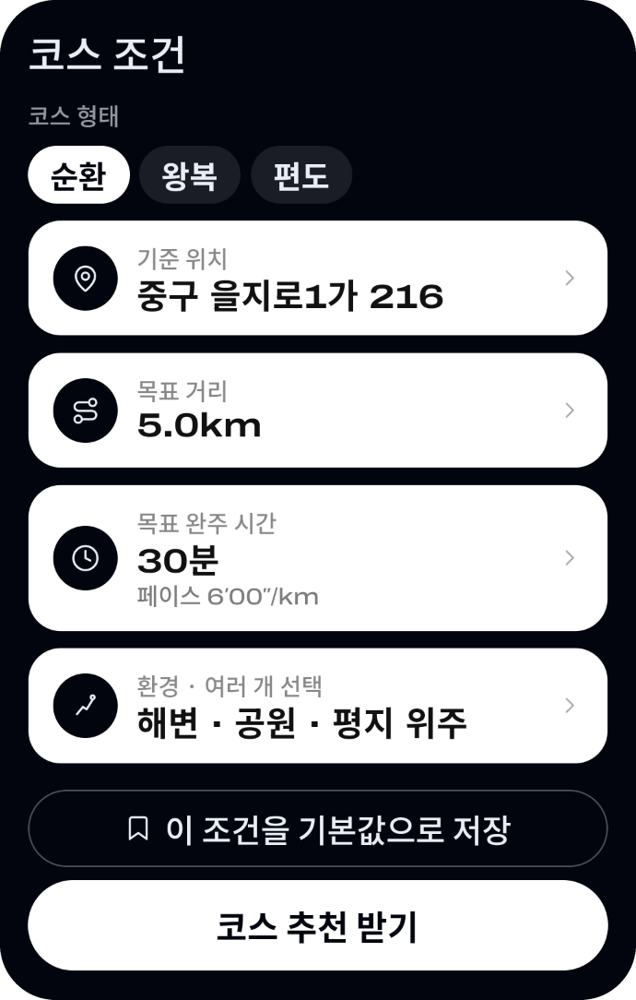 | 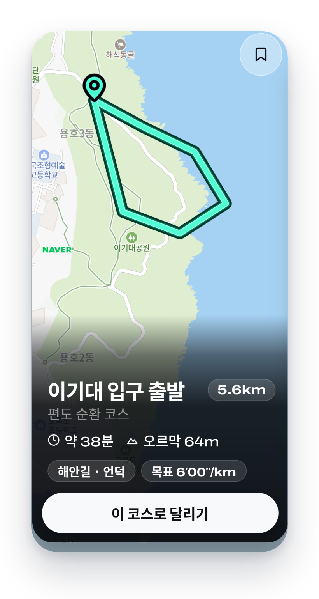 | 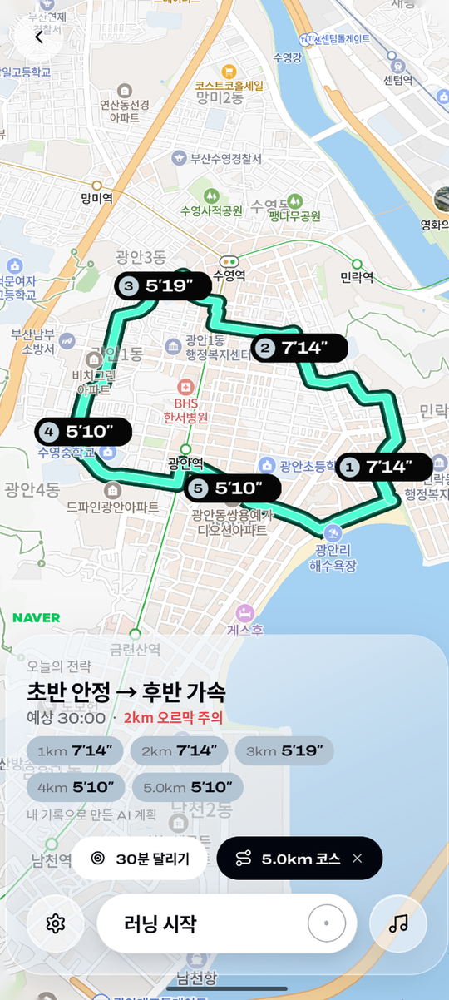 |

코스를 정하지 않고 자유롭게 달리거나 거리·시간·페이스 목표만 고를 수도 있습니다. 아래는 Android 앱에서 직접 촬영한 목표 설정 화면입니다.

| 목표 선택 | 목표 조절 | 오늘의 운동 준비도 |
| :---: | :---: | :---: |
| 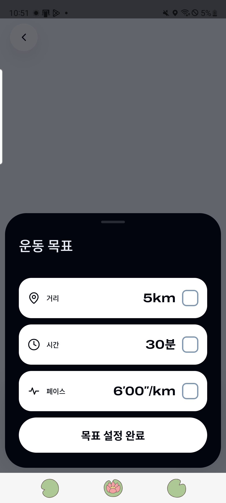 |  | 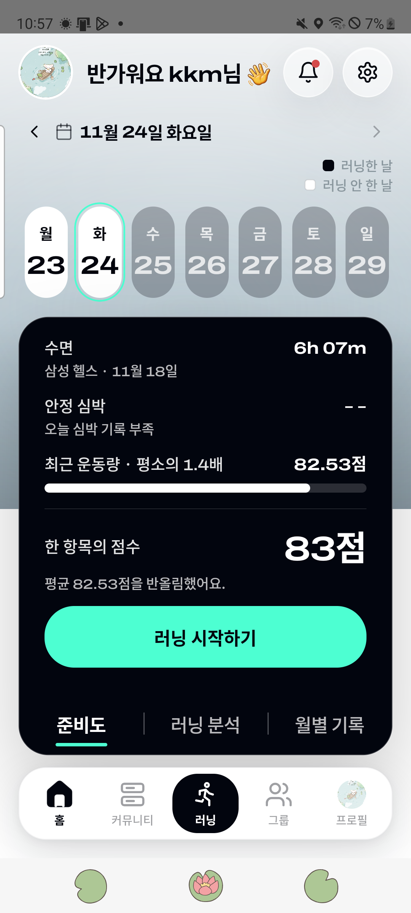 |

### 2. 달리는 동안 페이스를 맞춥니다

휴대폰은 GPS 경로와 거리·시간·페이스를 기록합니다. 워치에서는 심박수와 케이던스를 확인하고, 안내 페이스에 맞춘 진동 리듬과 음성 코칭을 받을 수 있습니다. 운동의 일시정지·재개·종료는 휴대폰과 워치가 함께 처리합니다.

| 러닝 시작 | 워치 코칭 | 러닝 지도 |
| :---: | :---: | :---: |
| 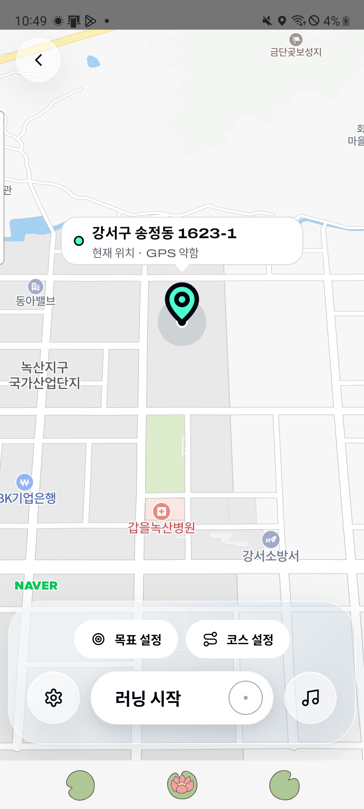 | 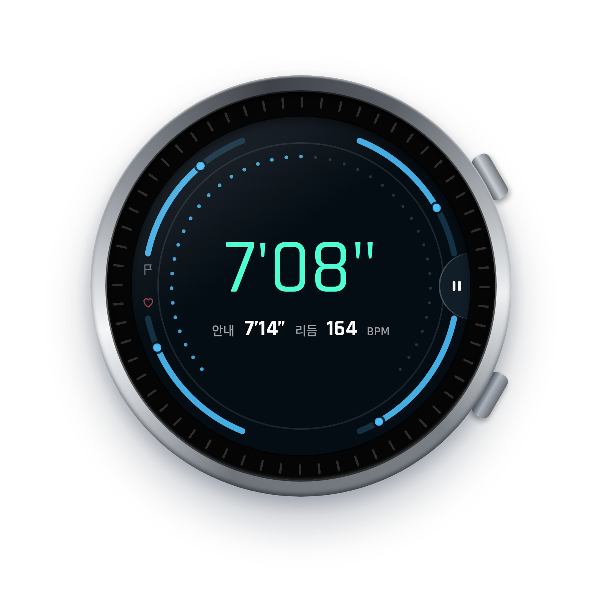 | 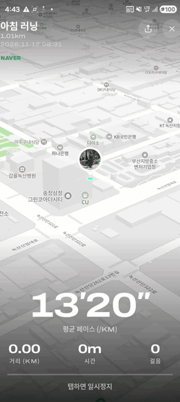 |

### 3. 끝난 뒤 다음 러닝을 준비합니다

기록에는 이동 경로와 구간별 페이스, 심박·케이던스 변화가 남습니다. 계획한 페이스와 실제 페이스를 비교해 어느 구간에서 차이가 났는지 확인할 수 있습니다. 기록 카드를 만들고 커뮤니티에 공유하는 흐름도 마련했습니다.

| 실제 앱의 분석 화면 | 발표자료의 목표 비교 화면 |
| :---: | :---: |
| 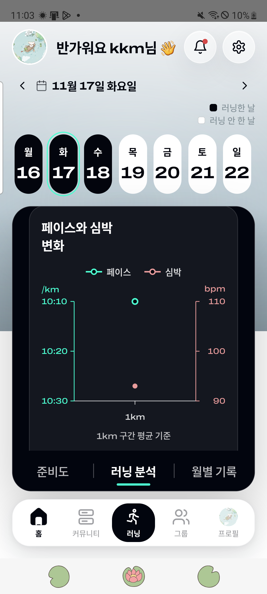 | 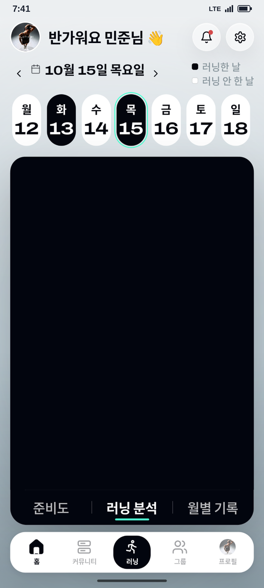 |

### 함께 달릴 때

크루와 그룹런을 만들고 참가자를 모을 수 있습니다. 그룹장은 공동 목표 페이스를 직접 정하거나, 참가자의 예상 심박을 고려한 추천 페이스를 선택할 수 있습니다. 출발 전에는 모두가 같은 구간별 계획을 확인하고, 러닝 중에는 참가자의 진행 상태를 공유합니다.

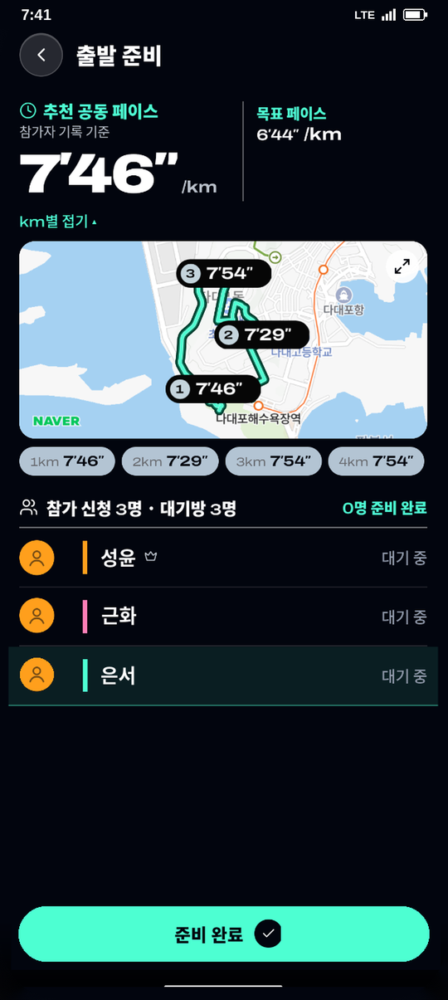

## 페이스를 계산하는 방법

**코스 추천.** 도로망에서 A* 탐색으로 후보 경로를 만들고, 거리·환경·순환 경로 같은 조건으로 추립니다. 발표 시연에서는 24개 후보를 만든 뒤 조건에 맞는 3개를 보여 줬습니다. 이 숫자는 시연 조건의 결과입니다.

**심박 예측과 페이스 계획.** 현재 속도와 심박, 최근 운동 기록, 코스 경사 등 러닝 데이터를 이용해 GRU 모델이 앞으로 약 2분간의 심박 변화를 예측합니다. 과거 기록을 반영한 개인화 보정을 거쳐, 코스의 각 구간에서 무리하지 않을 페이스를 계획합니다. 러닝 중에는 새로 들어오는 측정값을 바탕으로 안내 페이스를 다시 고릅니다.

**워치의 리듬 안내.** 목표 페이스를 숫자로만 보여 주지 않고 음성과 진동으로 전합니다. 같은 속도에서도 보폭은 사람마다 다르므로, 러닝 기록을 이용해 개인에게 맞는 진동 박자를 추정합니다.

발표자료에서 소개한 검증에서는 **학습에 쓰지 않은 러너의 기록으로 예측한 2분 뒤 심박의 평균 오차가 2.4%**였습니다. 별도로 진행한 사용자 만족도 조사에서는 **21명 중 18명이 4점 이상**, 평균 **4.3/5점**으로 응답했습니다. 두 수치는 발표 당시의 검증 및 설문 결과입니다.

### AI 구현 자세히 보기

- [코스 추천 기술 가이드](ai/route_service/ROUTE_TECHNICAL_GUIDE.md): 경로 후보 생성, 조건별 평가와 최종 순위
- [GRU 심박 예측 모델](ai/workspace/doyeon/gru/README.md): 입력 데이터, 모델 구조, 개인화와 검증
- [AI 서비스 API](docs/design/api/ai-service.md): 심박 예측을 출발 전 페이스 계획과 러닝 중 코칭에 연결하는 방식
- [개인 보폭·BPM 모델](ai/bpm/README.md): 러닝 기록에 맞춘 진동 박자 계산과 평가

## 구현 구성

| 영역 | 기술 | 역할 |
| --- | --- | --- |
| 모바일 | React Native, TypeScript, Naver Map | 러닝 흐름, 지도, 기록, 그룹런, 커뮤니티 |
| 워치 | Kotlin, Wear OS | 운동 측정과 제어, 페이스·진동 리듬 안내 |
| 서버 | Java, Spring Boot, PostgreSQL/PostGIS, Redis | 계정·기록·코스·그룹런 API와 실시간 상태 |
| AI | Python, FastAPI | 코스·페이스 분석과 심박 예측 |
| 배포 | Docker, Nginx, Jenkins | 서비스 배포와 빌드 |

휴대폰이 러닝 세션과 화면 흐름을 맡고, 워치는 운동 중 측정과 빠른 피드백에 집중합니다. 서버는 기록과 그룹 상태를 관리하고, 위치 기반 데이터는 PostGIS에 저장합니다. 연결 구조와 데이터 흐름은 [워치·휴대폰·서버 연동 문서](docs/design/watch-mobile-server-integration.md)에 정리했습니다.

## 더 보기

- [발표자료 PPTX](docs/assets/readme/RunWay-presentation.pptx) · [40초 소개 영상](docs/assets/readme/runway-film.mp4)
- [모바일 앱 실행 안내](frontend/README.md) · [워치 앱 실행 안내](wear/README.md)
- [기능 범위](docs/design/mvp.md) · [설계 문서 목록](docs/README.md)

이 README의 일부 화면과 GIF는 발표자료에서 가져왔고, 목표 설정·운동 준비도·러닝 시작·기록 분석 화면은 Android 앱에서 직접 촬영했습니다. PPTX는 GitHub에서 내려받을 수 있도록 삽입 영상만 용량을 줄인 사본입니다.
