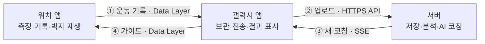
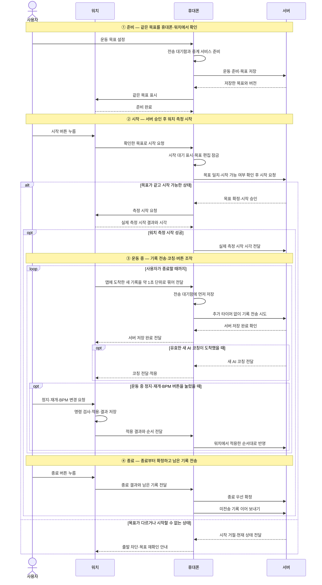
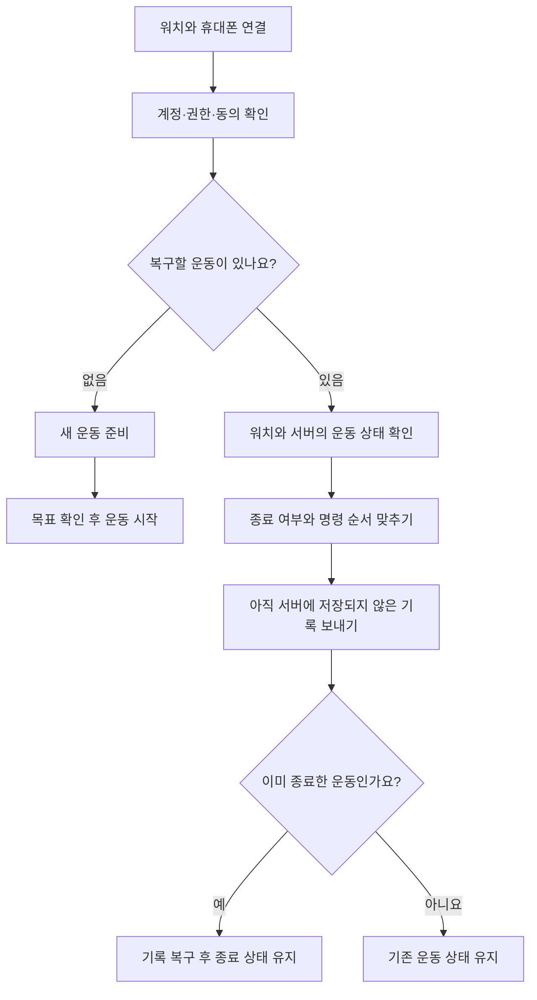
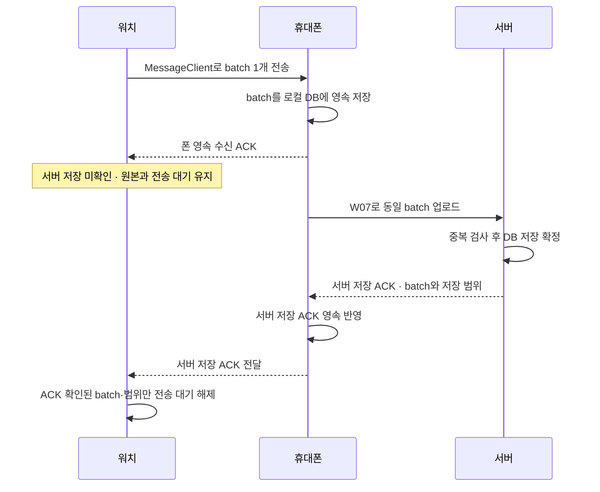

# 워치·휴대폰·서버 연동 흐름

> 업무: [S15P31E105-175](https://ssafy.atlassian.net/browse/S15P31E105-175) · 기준일: 2026-10-26
> 사용자와 확정한 MVP 흐름이다. API 필드·오류 응답은 기존 명세와 173번에서 구체화한다. 구현·실기기 검증 완료를 의미하지 않는다.

## 1. 지원 범위와 역할

- **이번 MVP:** Galaxy Watch + 갤럭시 휴대폰. 새 운동은 워치·폰·서버가 연결된 상태에서 시작한다.
- **후속 MVP:** Apple Watch + iPhone. 이번에는 iPhone과 휴대폰 단독 러닝·AI 코칭을 제공하지 않는다. 시작한 운동에서 폰 GPS로 기록을 이어가는 것은 아래 보완 정책에 포함한다.
- 워치는 측정·운동 제어·박자 재생, 폰은 보조 GPS 수집·기록 보관·인증·서버 중계, 서버는 저장·분석·AI 코칭을 담당한다.
- AI 팀 입력 요건에 따라 워치의 유효한 심박 등 필수 입력이 필요하다. 케이던스나 과거 심박으로 현재 심박을 대신하지 않는다.

## 2. 통신 구조

| 구간 | 사용 방식 |
| --- | --- |
| 워치↔폰 | 명령·현재 원본·누적 기록 복구는 MessageClient의 개별 메시지, 최신 상태 공유는 DataClient/DataItem. ChannelClient는 이번 MVP에서 제외 |
| 폰→서버 | 원본 업로드 W07, 건강 저장소 조회 기록 W06, 시작·정지·재개·종료·BPM은 기존 REST API |
| 서버→폰 | SSE로 상태·코칭 전달. 단절 후 구독과 현재 상태 조회를 복구하고 오래된 결과는 적용하지 않음 |

워치와 폰 앱은 같은 applicationId와 서명으로 배포한다. OS 페어링, W01 기기 등록, W05 동의 확인은 각각 별도의 절차다. 폰의 native 영역은 큐와 통신을 관리하고, RN 화면은 사용자 입력과 결과 표시를 담당한다.

서버도 인증, 기기·세션 소유권, 동의 상태를 검사한다. 토큰은 워치 메시지나 URL에 넣지 않는다. 건강/GPS 원본은 로그에 남기지 않는다.

| 전송 항목 | 주기·규칙 |
| --- | --- |
| 워치→폰 원본 | 센서 콜백마다 보내지 않고 아래 배치 생성 기준에 따라 전송 |
| 폰→서버 원본 | 받은 배치를 영속 저장한 뒤 바로 전송 시도. 요청 제한·재시도·남은 기록 복구는 6장 적용 |
| 시작·정지·재개·종료 | 배치 주기를 기다리지 않고 즉시 전달 |
| 코칭·BPM 가이드 | 유효한 새 결과가 있을 때 전달. 박자는 워치가 로컬에서 생성 |

**배치 생성 기준:** 워치 앱은 받은 새 원본을 약 1초 단위로 묶는다. 첫 구간에서 만든 묶음 A와 다음 구간의 묶음 B에는 서로 다른 배치 ID를 부여한다. 새 원본이 없으면 배치를 만들지 않는다.

배치를 직렬화했을 때 식별 정보를 포함한 전체 메시지가 32 KiB를 넘지 않도록 한다. 다음 항목을 넣으면 상한을 넘는 경우에는 배치를 나눈다. 측정값 하나만으로 상한을 넘으면 별도 오류로 처리하고, 해당 측정값을 조용히 버리지 않는다.

OS가 여러 초의 측정값을 한꺼번에 전달하면 크기 상한 안에서 함께 묶을 수 있다. 따라서 배치 하나가 정확히 1초 동안 측정한 기록을 뜻하지는 않는다. 각 항목의 원래 측정 시각·원본 ID·순번을 보존한다. 배치 생성이 끝나면 ID·내용·해시를 고정하고, 폰 중계·재전송·과거 복구에서도 그대로 사용한다.

센서 측정 주기, Health Services가 앱에 데이터를 전달하는 주기, 배치 전송 주기는 서로 다르다. 약 1초의 배치 주기가 최신 심박의 매초 도착이나 서버 저장·AI 계산의 1초 내 완료를 보장하지는 않는다.

폰이 받은 배치를 바로 전달하더라도 센서값마다 서버를 호출하는 것은 아니다. 정상 연결에서 크기 상한에 걸리지 않는 배치를 1초마다 하나씩 보내면 활동 세션당 약 1회/초를 호출한다. 폰의 추가 대기를 없애면 지연은 줄지만 서버 호출 부하까지 없어지지는 않는다. 크기 분할·제어·복구·재시도에 따른 호출은 별도로 발생하므로, 동시 세션 수에 따른 부하를 검증한다.

업로드·AI 계산·BPM 변경 주기는 각각 관리한다. AI 계산 중 새 데이터가 들어오면 다음 계산에 최신 입력을 반영하고, 원본은 모두 저장한다. 매초 업로드하더라도 BPM을 매초 변경하지는 않는다.

화면이 꺼지면 Health Services가 측정값을 모아서 앱에 전달할 수 있다. 워치는 실행 시 `HEART_RATE_5_SECONDS` 지원 여부를 확인한다. 지원 기기에서는 실시간 코칭 중 심박을 약 5초 간격으로 전달하는 것을 목표로 이 모드를 사용한다. 실제 간격은 기기 동작에 따라 달라질 수 있으며, 이 설정이 다른 지표의 전달 주기까지 바꾸지는 않는다.

미지원 기기는 기본 전달 동작을 사용한다. 지원 여부, 화면 꺼짐 상태의 실측 간격과 전력 영향을 표시·검증한다. 입력 유효 기간과 AI 중단은 5장의 규칙을 따른다.

**전송과 DB의 관계:** 폰은 워치 배치를 영속 저장한 뒤 W07 HTTPS 요청으로 서버에 전달한다. 현재 기록과 누적 기록은 같은 배치 형식을 사용하며 저장 확인·복구는 6장을 따른다. 통신 방식의 선택 이유와 대안은 [ADR-0012](../adr/0012-watch-phone-data-layer.md)에 기록한다.

| 서버 테이블 | 이 흐름에서의 역할 |
| --- | --- |
| `user_devices` | 회원에 연결된 기기를 관리한다. 서버가 요청 기기의 소유권·연결 상태를 확인하는 기준이며, OS 페어링이나 로컬 전송 대기함을 대신하지 않는다. |
| `sync_batches` | 클라이언트 배치 ID·기기·세션·해시·수신/저장 상태를 관리한다. 같은 배치 재전송을 식별하고 서버 저장 결과를 확인하는 처리 장부다. 실제 측정값·GPS 원본은 해당 데이터 테이블에 저장한다. |

서버는 정해진 배치 ID·기기 식별 범위에서 재요청 여부를 확인한다. 같은 배치의 내용 해시가 같으면 기존 결과를 반환하고, 내용이 다르면 충돌로 처리한다. 실제 원본 저장과 배치의 저장 완료 처리는 하나의 DB 트랜잭션으로 확정한다.

같은 원본 이벤트가 서로 다른 배치에 들어오면 배치 ID만으로는 중복을 제거할 수 없다. 이 경우에는 173번의 원본 중복 제거 계약을 따른다. 배치/원본 식별 범위·해시 규칙·부분 저장 정책·ACK도 173번에서 확정한다. 두 테이블은 ChannelClient 선택과 관계없이 사용하며, 이 문서가 기존 API·DB 계약을 직접 변경하지는 않는다.

전송 초기값은 ACK 대기 10초, 재시도 간격 1·2·4·8·16·30초(상한)와 jitter, SSE heartbeat 간격 15초, 무응답 판단 45초다. 배치 크기와 timeout은 구현 시 지연·전력을 측정해 조정한다. ACK 확인 단계는 명령의 경우 4장, 원본의 경우 6장을 따른다.

**GPS 출처 선택:** 유효한 최신 워치 GPS를 우선 사용한다. 폰도 운동 준비 화면에서 권한을 확인하고 GPS 수집을 시작하되, 운동 기록에는 실제 시작 이후의 위치만 사용한다. 워치 GPS가 늦거나 연결이 끊기면 폰 GPS로 현재 위치 표시와 코스 기록을 이어간다. 둘 다 유효하지 않으면 위치 미수집 구간으로 남긴다. 인터넷·서버 연결이 없어도 가능한 GPS 수집과 로컬 저장은 계속하며, AI 코칭 중단은 5장을 따른다.

워치·폰 GPS는 각각 원본 출처·기기·측정 시각·정확도를 보존하고, 같은 시간 구간의 두 출처를 중복 합산하지 않는다. 재연결 후 늦게 도착한 워치 GPS도 같은 유효성·워치 우선 규칙으로 구간별 출처 하나를 선택해 코스·거리를 다시 계산한다. 위치 출처가 바뀌거나 수집이 끊긴 구간을 무조건 직선으로 연결해 거리를 늘리지 않는다. 폰에서 만든 원본은 폰의 기기 ID와 별도 원본 ID·순번·배치로 보관하며 워치 원본으로 표시하지 않는다. GPS 유효성·수신 지연 판단·시각 보정·출처 전환 경계는 173번과 세션 API의 상세 계약에서 확정한다.

## 3. 정상 운동 흐름과 목표 고정

위 그림은 정상 연결의 개인 운동 흐름이다. 화살표는 전달 방향, `alt`는 성공/거절 분기, `opt`는 해당 조건일 때만 하는 동작, `loop`는 반복을 뜻한다. 운동 중 기록 전송·코칭 수신·버튼 조작은 각각 발생하며, 그림의 나열 순서대로 매번 모두 기다리는 것은 아니다. 폰에서 누른 제어 명령도 워치로 전달해 실제 적용 결과를 확인한다(4장). 전송 대기함은 앱이 종료돼도 남도록 로컬 DB에 보관하는 영속 큐다. 목표 고정은 출발 시 사용할 목표를 확정한다는 뜻이다.

서버의 S03(운동 시작 API)은 목표와 READY 상태를 검사한 뒤, 목표 고정과 시작 상태 변경을 원자적으로 처리한다. 즉, 이 절차 전체가 함께 성공하거나 함께 실패해야 한다. S08(목표 설정 API)도 목표를 저장할 때 READY 조건을 원자적으로 검사한다.

목표 A를 B로 바꾸는 요청이 먼저 성공했다면 A로 시작하려는 요청은 충돌 처리한다. 반대로 시작이 먼저 확정됐다면 뒤에 도착한 목표 수정은 거절한다. 폰은 결과를 아직 모르는 목표 수정 요청부터 확인하고, 워치와 같은 목표를 확인한 뒤 출발시킨다.

시작 응답이 유실되면 같은 명령으로 서버 상태와 목표를 확인한다. 확인을 위해 새 세션을 만들지는 않는다. 서버가 시작을 수락한 것과 워치 센서가 실제로 시작된 것은 구분한다. 워치 시작에 실패하면 상태를 다시 확인하고 필요한 경우 종료한다. 서버 수락 시각을 실제 센서 시작 시각으로 기록하지 않는다.

그룹런은 G09가 참가자별 목표·세션·시작을 확정한다. 참가자가 S01·S03을 따로 반복 호출하지 않는다. 확정 목표가 다르면 출발을 차단한다. 정상 그룹 종료는 실제 시작 참가자 전원의 개인 종료로 처리하고, 예외 강제 종료는 그룹장 G12로 처리한다. G12 종료 상태는 알림 설정과 관계없이 워치까지 적용한다.

## 4. 명령 충돌과 서버 반영 순서

**해당 세션의 명령을 실제로 적용하는 주체는 워치다.** 폰과 워치에서 버튼을 누른 시각을 비교하는 대신, 워치가 명령을 수락한 순서를 따른다. 연결이 끊겨도 적용 주체를 폰으로 자동 전환하지 않는다. 서버는 명령을 반영할 때 권한과 서비스 상태를 별도로 검사한다.

| 상황 | 확정 규칙 |
| --- | --- |
| 같은 기준에서 서로 다른 BPM 요청 | 기준 운동상태·BPM 버전을 검사해 처음 수락한 하나만 적용. 나머지는 미적용을 알리고 최신 값 표시 |
| 최신 값 확인 후 다시 변경 | 새 기준의 의도한 변경으로 수락. 첫 값에 영구 고정하지 않음 |
| 일시정지와 BPM 변경 경합 | 일시정지 우선. 이미 적용한 BPM 이력은 보존하되 박자·운동 제어는 정지. 늦은 이전 BPM을 재적용하지 않음 |
| 일시정지와 재개 경합 | 최신 PAUSED 상태를 확인한 새 재개만 허용. 과거 재개가 정지를 취소하지 않음 |
| 종료와 다른 명령 경합 | 종료 우선. 종료된 세션을 재개하거나 과거 BPM으로 되돌리지 않음 |
| 수동 BPM 이전 입력의 코칭 도착 | 오래된 코칭 미적용. 다음 계산은 새 수동 BPM을 입력으로 사용 |

운동상태 버전과 BPM 버전은 따로 관리한다. 따라서 BPM만 바뀌었다는 이유로 일시정지 요청을 거절하지 않는다. 정지 후 이미 재개한 운동에는 늦게 도착한 과거 정지 명령을 다시 적용하지 않는다. PAUSED 상태에서 BPM을 별도로 편집할 수 있는지는 P07 상세 계약에서 정한다.

서버까지 같은 순서를 유지하는 책임은 다음과 같다.

1. **워치:** 요청받은 동작과 명령에 배정한 순서를 먼저 저장한다. 실제 동작을 수행한 뒤 결과·버전·시각을 저장한다. 재시작 후 미완료 명령을 발견하면 실제 상태를 확인해 복구하며, 성공했다고 추정하지 않는다.
2. **폰:** 워치의 적용 결과를 영속 저장한 뒤 수신 ACK를 보낸다. 이 결과를 세션별 서버 반영 큐에 넣고 일반 명령은 한 건씩 보낸다. 이전 명령의 처리 결과를 확인하기 전에는 다음 명령을 병렬로 반영하지 않는다.
3. **서버:** 중복 명령인지, 다음에 반영할 순서가 맞는지 검사한다. 명령 결과·현재 상태·최종 반영 위치는 원자적으로 저장한다. 예상 순서와 다르면 상태를 바꾸지 않고, 어느 위치부터 복구해야 하는지 응답한다.
4. **복구:** 응답이 유실되면 원래 명령 ID로 결과를 다시 확인하고 실제 제어를 반복하지 않는다. 누락된 이력은 워치에서 복구한다. 현재 상태와 맞지 않는다는 오류만 보고 이력을 버리거나 새 ID로 재시도하지 않는다. 인증·동의 오류가 발생하면 재시도를 중단하고 원인을 해결한 뒤 복구한다. `정지→재개`는 서버에도 같은 순서로 반영한다.

종료는 대기 중인 일반 명령이나 과거 기록의 복구가 끝날 때까지 기다리지 않고 우선 확정한다. 폰은 일반 명령 발신을 멈추고, 원래 종료 요청·실제 시각·마지막 적용 위치를 서버에 전달한다. 늦게 도착한 일반 명령이 서버의 종료 상태를 되돌리지 못하게 한다.

**종료 확정 여부와 과거 이력이 연속으로 저장된 위치는 따로 관리한다.** 누락된 정지·재개·BPM 이력은 W07로 복구해 운동시간과 통계만 다시 계산한다. 종료 후 S04/S05를 재실행하지 않는다. 같은 명령이 REST 요청과 이력 배치에 모두 들어오더라도 한 번만 반영한다.

워치 연결이 끊겨 있어도 폰에서 서버 종료를 요청할 수 있다. 이때는 `서버 종료 확인 / 워치 실제 종료 미확인`을 표시하고, 재연결 시 워치도 종료한다. 종료 기준 이후에 측정한 기록은 해당 세션 집계에서 제외한다. 종료 기준과 실제 센서 종료 시각의 차이는 기록으로 남긴다. 그룹 강제 종료(G12) 기준 이전의 기록은 늦게 도착해도 복구한다.

## 5. AI 일시 중단과 연결 장애

**운동 상태와 AI 코칭 상태를 분리한다.** 심박·필수 입력 결측 또는 통신 단절로 멈추는 것은 새 AI 페이스 추천·자동 BPM 변경·새 AI 음성 안내·운동 부담 판정이다. 운동을 자동 일시정지하지 않는다.

- 가능한 센서의 측정·기록·시간 계산과 수동 정지·재개·종료를 유지한다.
- 기존 설정 BPM 박자 재생과 수동 BPM 조절을 유지한다. 연결이 필요한 폰 명령은 워치의 실제 적용 확인 전까지 대기로 표시한다.
- 마지막 BPM은 `기존 설정`으로 표시하며 최신 AI가 다시 계산한 값처럼 갱신하지 않는다. 오래된 AI 음성·코칭을 재생하지 않는다.
- 화면에는 `운동 중 · AI 코칭 일시 중단`과 이유를 표시한다. 유효한 입력·연결이 복구되고 운동 상태가 RUNNING이면 최신 데이터로 자동 재개한다.
- 센서가 멈췄거나 권한을 잃어 수집하지 못한 항목은 미수집으로 표시한다. 없는 심박·GPS·구간을 채우거나 과거 심박을 새 측정값으로 복제하지 않는다. 폰·서버 도착 시각으로 원래 측정 시각을 덮어쓰지도 않는다.
- AI 입력의 유효 시각과 품질 기준은 AI 계약에서 정한다. AI 팀과 필수 지표별 최대 허용 경과 시간, 필요한 입력 시간창, 시각 보정 오차를 확정한 뒤 코칭을 활성화한다. 약 1초의 전송 주기를 입력 유효 기간으로 대신 사용하지 않는다.

| 상황 | 동작 |
| --- | --- |
| 폰 화면 꺼짐·다른 앱 사용 | 허용된 중계 서비스에서 업로드·SSE·코칭 전달 계속 시도 |
| 폰 인터넷·서버 연결 불가 | 위 AI 중단 규칙 적용. 워치 수신 기록과 폰 GPS를 폰에 보관하고 서버 전송 복구 |
| 워치 연결 단절 | 워치는 자체 기록 보관, 폰은 2장의 GPS 보완 정책으로 위치·코스 기록 유지. 새 AI 코칭은 중단 |
| 폰 앱 강제 종료 | 워치 기록 계속. 폰 앱 재실행 시 영속 큐·명령 위치·서버 상태 복구 |
| 워치 운동 서비스 종료·전원 꺼짐 | 워치 센서 수집 중단과 AI 중단 표시, 저장한 기록 보존. 폰 GPS 보완은 계속하되 심박 등 워치 측정값을 생성하지 않음 |
| 연결 복구 | 서버 종료 여부·워치 상태·명령 순서를 먼저 맞추고 현재 원본 전송과 과거 복구 시작 |

화면·워치페이스 이동과 실제 앱/운동 서비스 강제 종료를 구분한다. 수집이 실제로 중단된 구간은 복구했다고 표시하지 않는다.

## 6. 보관과 전송 우선순위

| 핵심 규칙 | 처리 방법 |
| --- | --- |
| **① 전송 순서** | 제어 명령 → 현재 측정값 → 과거 기록 복구 순으로 전송 기회를 준다. 제어는 원본과 별도로 실행하고 명령 순서·종료 우선 처리는 4장을 따른다. 복구 대기열 안에서는 오래된 배치부터 보낸다. |
| **② 서버 지연 시 최신 입력 우선** | 다음 발신 시 측정 시각·품질을 확인해 최신 유효 배치를 선택한다. 더 오래된 대기 배치와 유효 기간이 지난 배치는 삭제하지 않고 복구 대상으로 옮긴다. 재연결 시에도 이미 쌓인 배치는 복구 대상으로 분류하고, 이후 새 원본은 현재 대상으로 분류한다. |
| **③ 재전송과 중복 방지** | 실패·응답 유실 배치는 2장의 ID·내용·해시 보존 규칙과 ACK 대기·지수 백오프를 따른다. 재시도 시 이미 오래됐다면 복구 대상으로 넘긴다. 새 배치를 선택해도 해당 서버·계정의 백오프를 초기화하거나 우회하지 않는다. 늦은 ACK는 원래 배치에만 반영한다. |
| **④ 저장 확인과 대기 해제** | 워치 저장·폰 영속 수신·서버 저장은 별도 단계다. MessageClient 발신 성공을 폰 영속 수신 ACK나 서버 저장 ACK로 취급하지 않는다. 폰 수신 ACK만으로 워치 원본을 삭제하지 않고, 서버가 저장했다고 확인한 배치·범위만 전송 대기에서 해제한다. |
| **⑤ 보관 예외** | 네트워크 부족·복구 지연 시 원본을 보관하고 지연을 표시한다. 저장 한도에 도달해도 미확인 원본을 자동 폐기하지 않고 수집 중단·용량 부족을 표시한다. 계정 전환·기기 해제 시 큐를 격리하고 동의 철회 시 해당 수집·전송을 중단한다. 앱 삭제·기기 분실로 사라진 미전송 로컬 기록은 복구를 보장하지 않는다. |

현재·복구 실행자는 하나의 영속 저장소를 사용하되 각각 한 배치만 전송한다. 응답 또는 timeout까지 다음 요청을 보내지 않으며, 같은 배치를 동시에 가져가지 않도록 소유 상태를 저장한다. 복구 실행자는 매 배치 경계에서 현재 원본의 대기를 확인하고 대기가 해소된 여유로 진행한다. 진행 중인 복구의 자원 점유는 2장의 배치 크기 상한과 timeout으로 제한한다.

서버는 항목별 측정 시각과 AI 입력 시간창을 검사한다. 최신 배치 하나만으로 필요한 입력이 충족됐다고 가정하지 않으며, 부족하면 5장의 AI 중단 규칙을 따른다. 과거 복구 원본은 기록·통계에만 사용하고 새 코칭을 만들지 않는다. 늦게 도착한 원본·계산 결과가 최신 코칭을 덮어쓰지 못하게 한다.

**개별 배치의 저장 ACK와 연속 저장 위치는 구분한다.** 1~80과 101~110이 저장됐어도 연속 위치는 80이다. 101~110의 ACK로 81~100까지 저장됐다고 판단하지 않으며, 과거 순번이 비어 있어도 현재 전송은 허용한다. 유효한 새 입력을 보내지 못하면 전송 지연을 표시하고 5장의 AI 중단 규칙을 적용한다.

## 7. Android 실행과 종료

- 폰은 운동 준비 화면에서 연결·위치 권한과 위치 서비스 설정을 확인한 뒤 필요한 foreground service(FGS)와 알림을 시작한다. 화면이나 RN이 닫혀도 native 영역에서 큐·중계·보조 GPS 수집을 관리한다. 기능에 맞는 FGS 유형과 실행 전제 조건을 지킨다.
- 워치는 사용자 시작과 확정 목표를 확인해 Health Services 운동 실행·필요 권한을 구성한다. 화면 꺼짐 중 수집·제어·박자를 유지하되 실제 실행 중단은 5장대로 표시한다.
- **워치 종료:** 종료 의도와 순서를 저장하고 센서 측정을 종료한 뒤, 실제 종료 결과·시각·마지막 원본 순번을 영속 저장한다. 종료 결과를 우선 폰에 전달하고 남은 배치를 이어 보낸다. 폰이 없거나 응답하지 않으면 저장 미확인 배치를 영속 큐에 보관한다. 기록 전송을 기다리며 센서 측정을 계속하거나 운동 서비스를 무기한 유지하지 않는다.
- **워치 재연결:** 폰이 연결된 워치에 해당 세션의 종료 상태와 저장 미확인 배치 목록을 요청한다. 워치는 영속 저장한 종료 결과·마지막 순번·남은 배치를 응답한다. 폰은 서버 상태와 W08 저장 위치를 확인하고, 부족한 ACK 범위는 같은 배치의 W07 재요청으로 확인한다. 6장에 따라 미확인 배치만 전달·재전송하고, 서버 저장 ACK를 워치에 돌려준다. 응답 유실 시 동일 ID·내용을 유지하며 종료된 운동을 다시 시작하지 않는다.
- **워치 전송 재개 기회:** 재연결 후 허용된 백그라운드 수신·실행 기회 또는 워치 앱 재실행 시 위 절차를 시도한다. 앱 강제 종료·전원 꺼짐 등으로 워치가 응답하지 못하면 기록을 보관한 채 복구 대기로 표시하고, 필요한 경우 앱 실행을 안내한다. 단순 재연결만으로 자동 전송이나 완료 시각을 보장하지 않는다.
- **폰 종료 후 업로드:** 운동 종료 후 최대 2분 동안 폰에 저장된 잔여 기록의 서버 전송을 시도한다. 끝내지 못한 배치는 영속 큐에 유지하고 WorkManager에 후속 업로드를 예약한다. WorkManager가 워치에만 있는 기록을 직접 가져오는 것은 아니며, 먼저 위 재연결 절차로 폰에 전달해야 한다. 이후 들어온 배치도 폰 영속 저장 후 업로드 대상으로 등록한다.
- **폰 재실행·서비스 정리:** 종료 여부·미확인 명령·서버 저장 위치를 먼저 확인해 복구하고, 결과 화면은 현재 분석 상태를 조회한다. 서버 종료, 워치의 실제 종료, 기록 동기화 완료 여부는 구분해 표시한다. 분석 완료를 기다리며 서비스를 무기한 유지하지 않으며, WorkManager의 정확한 실행 시각이나 앱 강제 종료 후 자동 재시작도 보장하지 않는다.

### 초기 연결·재연결 동기화

먼저 전체 흐름을 보고, 기록을 전달하는 과정은 다음 시퀀스에서 확인한다. 두 그림은 2·4·6장과 위 실행·종료 규칙을 요약한 것이다. 실제 요청 필드·ACK 범위는 173번과 기존 API에서 구체화한다.

**전체 흐름**

최초 연결에서는 3장의 목표 확인·온라인 시작 흐름으로 진행한다. 기존 운동의 상태 확인에는 서버의 종료 여부·명령 반영 위치와 워치의 실제 상태·종료 결과·마지막 순번·미확인 배치 목록 조회가 포함된다. 서버에서 종료된 운동은 워치에도 종료를 적용하고, 실제 종료 결과를 영속 저장한다. 종료된 운동을 다시 시작하지 않는다.

운동 중에는 과거 기록 복구를 끝낼 때까지 현재 기록 전송을 기다리지 않는다. 6장의 우선순위로 두 작업을 진행하며, PAUSED 상태는 유지한다. RUNNING 상태에서 유효한 최신 입력과 연결이 복구되면 AI 코칭을 재개한다.

**batch 1개의 전달과 저장 확인**

폰 영속 수신 ACK는 휴대폰의 로컬 저장 완료, 서버 저장 ACK는 해당 batch·범위의 서버 저장 완료를 뜻한다. 폰 수신 ACK만으로 워치 원본을 삭제하지 않는다. 폰에 이미 보관된 배치는 워치에서 다시 받는 단계를 생략하고 서버 업로드·저장 결과 확인부터 진행한다.

**예외 상황과 복구**

| 상황 | 처리 |
| --- | --- |
| 인증·소유권·동의 확인 실패 | 수집·전송 중단 또는 계정별 큐 격리. 원인을 해결한 뒤 복구한다. |
| 서버 조회 실패·응답 유실 | 미저장이나 세션 부재로 단정하지 않는다. 큐와 상태를 보존하고 4·6장의 재확인·재시도를 적용한다. |
| 워치가 꺼져 있거나 응답하지 않음 | 복구 대기를 표시하고 필요하면 워치 앱 실행을 안내한다. 폰에 이미 저장된 배치는 별도로 업로드한다. |
| 서버 저장 여부가 불명확함 | W08로 연속 저장 위치를 조회한다. 그 이후도 개별 저장됐을 수 있으므로, ACK 없는 범위는 동일 배치의 W07 재요청으로 확인한다. |
| 기록 전송·ACK 유실 | 원본을 보관하고 같은 ID·내용·해시로 재시도한다. 서버 저장 확인이 워치에 도착할 때까지 워치의 전송 대기를 유지한다. |
| 오래된 기록이나 코칭 도착 | 과거 기록은 복구·재집계에 사용하고 과거 코칭은 적용하지 않는다. 현재 기록 우선순위와 백오프는 6장을 따른다. |

## 8. 구현 전 연결할 계약과 검토 기준

| 기준 문서·업무 | 구체화할 내용 |
| --- | --- |
| [173번](https://ssafy.atlassian.net/browse/S15P31E105-173), [W07/W08](api/devices-health.md) | 원본·배치 ID, 순번 범위, 부분 ACK, 명령 중복·버전·반영 위치, 종료 후 이력 배치, 폰 GPS 원본·기기·스트림 매핑 |
| [세션 API](api/sessions.md), [그룹 API](api/group-runs.md) | 목표 스냅샷·원자 검사, 명령 순서·재시도 응답, 실제 적용 시각과 종료 기준, GPS 유효성·지연 판단·시각 보정·구간별 출처 선택 |
| [요구사항](requirements.md), [AI/BPM API](api/pace-coaching.md) | 갤럭시 전용 MVP, 필수 심박 입력, 지표별 유효 기간·입력 시간창·시각 보정, AI만 중단·복구, 가이드 유효 조건 |
| [ADR-0012](../adr/0012-watch-phone-data-layer.md)·배포 설정 | 채택한 전송 방식의 구현, 최종 앱 ID·서명·권한, 대상 기기·OS 및 복구 처리량 검증 |

W07은 원본 배치를 업로드하고 저장 결과를 확인하는 API다. W08은 서버에 원본이 어느 순번까지 연속으로 저장됐는지 조회하는 API다. 전체 흐름은 이 문서에서 정하고, 상세 필드와 판정 규칙은 위 API 계약에 반영한다. 현재 API가 명령 큐와 복구에 필요한 기능을 이미 모두 제공한다는 뜻은 아니다.

실험용 [업로드 v2](api/wear-upload-api.md)는 별도 계약이다. 이 MR은 설계 문서 변경이며 제품 코드·API/DB·운영 배포 변경은 포함하지 않는다.

다음은 구현 시 검증할 인수 기준이다. 문서 작성만으로 실행한 시험은 아니다.

| 검증 묶음 | 기대 결과 |
| --- | --- |
| 지원 환경·기기 식별·동의·계정 전환 | 지원 조합과 본인 세션만 처리. 미지원·권한 부족·큐 격리 구분 |
| 온라인 시작·목표 경합·응답 유실 | 같은 목표로 한 번 시작. 충돌 시 출발 차단. 서버 수락과 실제 시작 구분 |
| 동시 BPM·정지/재개·중복·과거 코칭 | 첫 수락·정지 우선·버전 검사. 워치와 서버 적용 순서 일치 |
| 종료 우선·그룹 강제 종료·지연 이력 | 폰 미연결 상태에서 워치 종료 후 재연결·앱 재실행으로 남은 배치 복구. ACK 유실에도 재시작·중복 저장 없이 서버 저장 확인. 종료 기준 이전 기록·정지 구간만 복구하고 과거 코칭 재생 금지 |
| 화면 꺼짐·절전·강제 종료·센서 중단 | 심박 배칭 모드 지원·미지원, 화면 꺼짐 중 실제 앱 전달 간격·전력과 AI 입력 유효 기간을 검증. 5장대로 계속/중단/복구를 구분하고 미수집 구간을 채우지 않음 |
| 심박·통신 끊김과 복구 | AI만 중단하고 기록·가능한 수동 제어·기존 박자 유지. 워치 GPS 단절·지연 시 폰 GPS로 코스를 이어가고, 재연결 후 중복 거리·허위 연결 구간이 없는지 확인. 최신 유효 입력으로 AI 자동 재개 |
| 큰 복구 backlog·서버 지연·ACK 유실·용량 부족 | 연결 유지 중 응답이 2초 이상 걸리거나 배치가 반복 실패해도 다음 발신은 최신 유효 배치 우선. 오래된 배치 복구 이관·원본 보존·백오프 유지·늦은 ACK 중복 방지 확인 |
| 실제 단말·전력·서버 부하 | 센서 콜백별 호출·빈 요청·폰 추가 타이머가 없는지 확인. 동시 세션별 호출량과 분할·복구·재시도 부하, 전송·저장·AI 계산·기기 적용 지연을 나눠 측정. 약 1초 묶음을 전체 완료 보장으로 보고하지 않음 |

기술 근거(확인 2026-10-26): Health Services는 저장소의 `health-services-client:1.1.0`을 기준으로 확인했다. 배칭 규칙의 근거는 [운동 데이터 전달](https://developer.android.com/health-and-fitness/health-services/active-data#control-the-batching-rate)·[BatchingMode](https://developer.android.com/reference/androidx/health/services/client/data/BatchingMode) 공식 문서다(해당 API는 1.0.0부터 제공, 기기 지원은 별도 확인). Data Layer의 기술 근거는 [ADR-0012](../adr/0012-watch-phone-data-layer.md)를 따른다. [Android FGS](https://developer.android.com/develop/background-work/services/fgs/service-types)·[실행 조건](https://developer.android.com/develop/background-work/services/fgs/launch)(현재 대상 SDK: 폰 36·워치 37), [작업 예약](https://developer.android.com/develop/background-work/background-tasks/persistent), [Spring MVC SSE](https://docs.spring.io/spring-framework/reference/web/webmvc/mvc-ann-async.html). 공식 문서는 기술 참고이며 저장소 버전의 동작·실기기 성능 검증을 대신하지 않는다.
