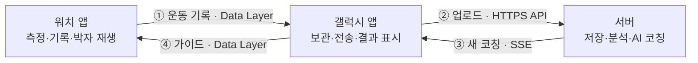
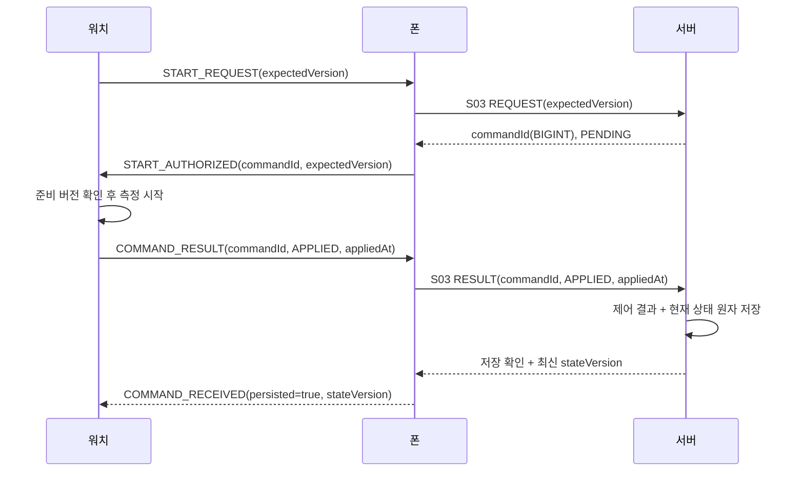
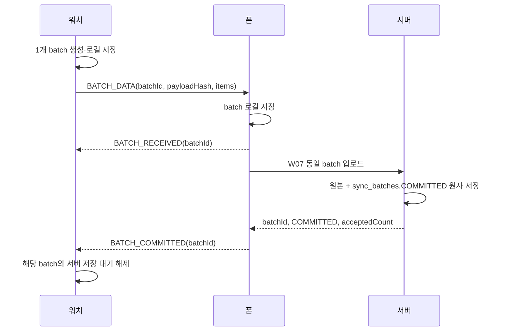

# 워치·휴대폰·서버 연동 흐름

> 업무: [S15P31E105-175](https://ssafy.atlassian.net/browse/S15P31E105-175) · 기준일: 2026-10-27
> 사용자와 확정한 MVP 흐름이다. **온라인 운영 전제:** 워치 기록은 폰 모바일 데이터·핫스팟과 워치 인터넷 연결을 유지하고, 2026-11-12 확정한 워치 없는 개인 러닝은 폰 인터넷을 유지한다. 인터넷 단절 중 운동 지속·장기 보관·재연결 전체 복구는 이번 MVP에서 제외한다. API·실제 적용·저장·시각 계약은 [173번 확정 계약](api/devices-health.md#173번-온라인-확정-계약)을 따른다. 설계 승인과 코드 구현·실기기 검증은 구분한다.

## 1. 지원 범위와 역할

- **이번 MVP:** Galaxy Watch + 갤럭시 휴대폰. 휴대폰은 데이터·핫스팟을 켜고 워치도 인터넷에 연결한다. 워치↔폰 통신과 서버 접근을 확인한 뒤 시작하며 운동 중 폰 인터넷을 유지한다. 워치 연결이 끊겨도 사용자가 폰으로 기록을 인계해 종료·저장할 수 있다.
- **이번 MVP의 폰 단독 개인 러닝:** 연결된 워치가 없으면 별도 선택 없이 휴대폰 기록으로 시작한다. 위치 권한이 거부됐거나 GPS를 사용할 수 없으면 시작을 막고 권한·위치 설정을 안내한다. 폰 GPS로 기록하고 폰에서 일시정지·재개·종료·저장하며 워치 심박·케이던스와 AI/BPM 가이드는 제공하지 않는다. 연결된 워치가 있으면 기존 워치 기록 흐름을 유지한다.
- **후속 MVP:** Apple Watch + iPhone. 이번에는 iPhone을 제공하지 않는다. 이미 시작한 워치 운동을 폰 GPS로 이어가고 폰에서 종료·저장하는 경로도 이번 MVP에 포함하며 AI/BPM 가이드는 중단한다.
- 워치는 측정·운동 제어·박자 재생, 폰은 보조 GPS 수집·기록 보관·인증·서버 중계, 서버는 저장·분석·AI 코칭을 담당한다.
- AI 팀 입력 요건에 따라 워치의 유효한 심박 등 필수 입력이 필요하다. 케이던스나 과거 심박으로 현재 심박을 대신하지 않는다.

## 2. 통신 구조



| 구간 | 사용 방식 |
| --- | --- |
| 워치↔폰 | 명령·현재 원본·온라인 요청 재시도는 MessageClient의 개별 메시지, 최신 상태 공유는 DataClient/DataItem. ChannelClient는 이번 MVP에서 제외 |
| 폰→서버 | 원본 업로드 W07, 워치 일상 심박 하루 추정값 W06(건강 저장소 기록은 후속 `type`), 시작·정지·재개·종료·BPM은 기존 REST API |
| 서버→폰 | SSE로 상태·코칭 전달. 온라인 응답 지연·수신 상태를 구분하고 오래된 결과는 적용하지 않음 |

워치와 폰 앱은 같은 applicationId와 서명으로 배포한다. OS 페어링, W01 기기 등록, W05 동의 확인은 각각 별도의 절차다. 폰의 native 영역은 큐와 통신을 관리하고, RN 화면은 사용자 입력과 결과 표시를 담당한다.

서버도 인증, 기기·세션 소유권, 동의 상태를 검사한다. 토큰은 워치 메시지나 URL에 넣지 않는다. 건강/GPS 원본은 로그에 남기지 않는다.

| 전송 항목 | 주기·규칙 |
| --- | --- |
| 워치→폰 원본 | 센서 콜백마다 보내지 않고 아래 배치 생성 기준에 따라 전송 |
| 폰→서버 원본 | 받은 배치를 영속 저장한 뒤 바로 전송 시도. 요청 제한·재시도·미확인 batch 처리는 6장 적용 |
| 시작·정지·재개·종료 | 배치 주기를 기다리지 않고 즉시 전달 |
| 코칭·BPM 가이드 | 새 적용은 유효한 결과만 전달. 승인된 미확정 코칭은 만료 후에도 같은 명령을 결과 확인용으로 재전달. 박자는 워치가 로컬에서 생성 |

**배치 생성 기준:** 워치와 폰은 자신이 생산한 새 원본을 최대 5초 동안 모아 배치를 생성·전송한다. 폰은 워치에서 받은 완성 배치를 다시 5초 동안 대기시키지 않고 바로 서버로 중계한다. 종료 시에는 남은 원본을 5초가 되기 전이라도 마지막 배치로 전송한다. 첫 구간에서 만든 묶음 A와 다음 구간의 묶음 B에는 서로 다른 배치 ID를 부여한다. 새 원본이 없으면 배치를 만들지 않는다.

배치를 직렬화했을 때 식별 정보를 포함한 전체 메시지가 32 KiB를 넘지 않도록 한다. 다음 항목을 넣으면 상한을 넘는 경우에는 배치를 나눈다. 측정값 하나만으로 상한을 넘으면 별도 오류로 처리하고, 해당 측정값을 조용히 버리지 않는다.

OS가 여러 초의 측정값을 한꺼번에 전달하면 크기 상한 안에서 함께 묶을 수 있다. 따라서 배치 하나가 정확히 5초 동안 측정한 기록을 뜻하지는 않는다. 생산 기기의 로컬 기록에서는 원래 측정 시각과 배치 편입 위치를 보존한다. 원본 ID·순번이 W07 필드나 서버 ERD 컬럼이라는 뜻은 아니다. 서버 전송·저장은 W07이 지원하는 측정값/GPS 필드에 한정한다. 배치 생성이 끝나면 ID·내용·해시를 고정하고, 폰 중계·온라인 요청 재시도에서도 그대로 사용한다.

센서 측정 주기, Health Services가 앱에 데이터를 전달하는 주기, 배치 전송 주기는 서로 다르다. 5초 배치 주기는 앱에 도착한 데이터를 모으는 시간이다. 센서 데이터가 앱에 전달되기까지의 지연이나 네트워크·서버 처리 시간을 포함한 전체 지연이 5초 이내라는 뜻은 아니다.

폰이 받은 배치를 바로 전달하더라도 센서값마다 서버를 호출하는 것은 아니다. 정상 연결에서 크기 상한에 걸리지 않는 생산 기기 하나가 배치를 5초마다 하나씩 보내면 약 0.2회/초(분당 12회)를 호출한다. 폰이 별도 GPS 배치를 생산하면 해당 요청이 추가된다. 폰의 추가 대기를 없애면 지연은 줄지만 서버 호출 부하까지 없어지지는 않는다. 크기 분할·제어·재시도에 따른 호출은 별도로 발생하므로, 동시 세션 수에 따른 부하를 검증한다.

서버는 새 배치의 저장이 끝나면 최신 입력으로 코칭 필요 여부를 판단한다. 업로드·AI 계산·BPM 변경 주기는 각각 관리한다. AI 계산 중 새 데이터가 들어오면 다음 계산에 최신 입력을 반영하고, W07이 지원하는 측정값/GPS 항목은 배치 저장 규칙에 따라 저장한다. 미지원 SDK 원본 필드를 저장한 것으로 표시하지 않는다. 5초마다 업로드하더라도 매번 코칭을 발행하거나 BPM을 변경하지는 않는다. 코칭의 입력 신선도·만료는 실제 측정 시각에 기반한 기존 20초 기준을 유지한다.

화면이 꺼지면 Health Services가 측정값을 모아서 앱에 전달할 수 있다. 워치는 실행 시 `HEART_RATE_5_SECONDS` 지원 여부를 확인한다. 지원 기기에서는 실시간 코칭 중 심박을 약 5초 간격으로 전달하는 것을 목표로 이 모드를 사용한다. 실제 간격은 기기 동작에 따라 달라질 수 있으며, 이 설정이 다른 지표의 전달 주기까지 바꾸지는 않는다.

미지원 기기는 기본 전달 동작을 사용한다. 지원 여부, 화면 꺼짐 상태의 실측 간격과 전력 영향을 표시·검증한다. 입력 유효 기간과 AI 중단은 5장의 규칙을 따른다.

**전송과 DB의 관계:** 폰은 워치 배치를 영속 저장한 뒤 W07 HTTPS 요청으로 서버에 전달한다. 현재 기록과 재시도 요청은 같은 배치 형식을 사용하며 저장 확인은 6장을 따른다. 통신 방식의 선택 이유와 대안은 [ADR-0012](../adr/0012-watch-phone-data-layer.md)에 기록한다.

| 서버 테이블 | 이 흐름에서의 역할 |
| --- | --- |
| `user_devices` | 회원에 연결된 기기를 관리한다. 서버가 요청 기기의 소유권·연결 상태를 확인하는 기준이며, OS 페어링이나 로컬 전송 대기함을 대신하지 않는다. |
| `sync_batches` | 클라이언트 배치 ID·기기·세션·해시·수신/저장 상태를 관리한다. 같은 배치 재전송을 식별하고 서버 저장 결과를 확인하는 처리 장부다. 실제 측정값·GPS 원본은 해당 데이터 테이블에 저장한다. |

서버는 정해진 배치 ID·기기 식별 범위에서 재요청 여부를 확인한다. 같은 배치의 내용 해시가 같으면 기존 결과를 반환하고, 내용이 다르면 충돌로 처리한다. 실제 원본 저장과 배치의 저장 완료 처리는 하나의 DB 트랜잭션으로 확정한다.

같은 원본 이벤트가 서로 다른 배치에 들어오면 배치 ID만으로는 중복을 제거할 수 없다. 생산 기기가 같은 로컬 원본을 여러 batch에 편입하지 않도록 원자적으로 기록한다. 서버는 현재 ERD로 다른 batch 사이 원본 단위 중복 제거를 보장하지 않는다. 배치 식별·해시·전체 저장·ACK는 173번 W07 계약을 따른다. 기존 두 테이블을 사용하며 ERD·Flyway는 변경하지 않는다.

ACK 대기 10초, SSE heartbeat 간격 15초·무응답 판단 45초는 기존 초기값이다. 재시도는 온라인 MVP에 맞춰 173번에서 최초 1회·추가 최대 2회, 1초·2초와 jitter를 추천했다. 이는 승인된 초기 운영값이며 실제 기기와 부하 시험으로 검증한다. 이전의 장기 재시도 정책은 적용하지 않는다. 배치 크기와 timeout은 실측으로 검증한다. 명령의 권한·단일 버전 검사는 4장을 적용하고, 명령과 원본 모두 결과 미확인을 성공으로 바꾸지 않는다.

**GPS 출처 선택:** 워치가 연결되어 있고 해당 측정 구간의 유효한 워치 GPS가 들어오면 워치 위치를 사용한다. 해당 구간의 워치 GPS가 없거나 유효하지 않으면 휴대폰 GPS로 보완한다. 폰도 준비 화면에서 권한을 확인하고 GPS를 수집하되 실제 운동 시작 이후 위치만 집계한다. GPS 보완은 위치 데이터의 출처 선택이며 기록 제어기기를 바꾸지 않는다. 폰 인터넷 단절 중 운동을 계속하는 기능은 이번 범위에 넣지 않는다. 워치 연결만 끊긴 경우에는 S08 TAKE_OVER_PHONE으로 인계한 뒤 폰 GPS를 사용한다. 코스 조회·커뮤니티는 폰 인터넷이 유지되면 워치 없이 사용할 수 있다.

처음부터 연결된 워치가 없는 개인 러닝은 GPS 보완이나 S08 인계가 아니라 폰 단독 기록이다. 시작 전에 폰 위치 권한·GPS 사용 가능 여부를 확인하고, 거부·사용 불가이면 시작을 막고 조치를 안내한다. 시작 후 W07은 폰 GPS를 출처로 전송하며 워치 측정값을 채워 넣지 않는다.

워치·폰 GPS의 출처·기기·측정 시각·정확도를 구분하고 같은 시간 구간의 두 출처를 중복 합산하지 않는다. 위치 출처 전환이나 결측 구간을 무조건 직선으로 연결하지 않는다. 시각·GPS 선택은 9.7절의 시각 기준과 구간별 출처 선택·정확도 기준을 따른다. 측정값은 W07 지원 필드로 한정하고, 현재 상태·최소 제어 결과·코칭 기준 버전/만료만 ERD에 추가한다.

## 3. 정상 운동 흐름과 목표 고정

WATCH 모드에서는 폰·워치 모두 서버 승인 후 실제 워치 제어를 실행한다. 명령 ID는 서버가 발급한 BIGINT다. 폰/워치가 UUID나 독립 명령 순번을 만들지 않는다. 워치 버튼은 START_REQUEST 또는 폰 방향 COMMAND_REQUEST로 먼저 요청하며, 서버 승인 전 센서·박자를 변경하지 않는다.

PHONE_ONLY 모드는 연결된 워치가 없는 개인 러닝을 S01에서 `controlDeviceId=relayDeviceId=phone`, `recordingMode=PHONE_ONLY`로 생성한다. 폰이 현재 제어기기이자 실행기기이며 S03 START, S04 PAUSE, S05 RESUME, S06 END 모두 폰에서 REQUEST 승인 → 로컬 실행 → RESULT 보고 순서로 처리한다. 워치 메시지·워치 준비 응답을 기다리지 않는다. 승인 전 GPS 기록·타이머를 시작하지 않으며, 위치 권한 거부나 GPS 사용 불가 시 시작 요청을 진행하지 않고 설정을 안내한다. 기존 WATCH 모드와 워치 단절 후 S08 인계 흐름은 유지한다.



폰으로 기록을 넘긴 뒤에는 위 흐름의 폰↔워치 전달·실행 구간을 폰의 로컬 실행으로 바꾼다. 서버 승인과 RESULT 보고 단계는 같다.

그룹장은 G09에 본문 없이 출발을 요청한다. 서버는 현재 그룹에 연결된 READY 세션 전체의 목표·제어 워치·동의·상태 버전을 잠금 아래 확인하고 START를 일괄 승인한다. 그룹장 앱이 참가자의 워치 ID나 버전을 조회·전송하지 않는다. 응답 유실로 G09를 다시 호출해도 최초 대상·명령·승인 버전을 반환하며 새 START를 만들지 않는다.

**워치는 최신 운동 설정으로 준비한 뒤 시작한다.**

1. 폰은 서버에 저장된 운동 목표와 상태 버전(`stateVersion`)을 워치에 보낸다(`SESSION_PREPARE`). 목표는 S01에서 처음 저장하고 S08에서 수정한다.
2. 워치는 전달받은 설정으로 운동을 시작할 준비가 되면 폰에 준비 완료를 알린다(`SESSION_PREPARED.ready=true`). 목표가 바뀌면 서버의 상태 버전도 올라가므로, 폰은 새 설정을 보내 워치를 다시 준비시킨다.
3. 시작 승인을 받은 워치는 **자신이 준비한 버전과 서버가 승인한 버전이 같은지** 확인한다. 다르면 시작을 거절한다. 예를 들어 워치는 아직 5km 목표로 준비돼 있는데 서버에서는 10km로 바뀌었다면, 새 설정으로 준비하기 전까지 시작하지 않는다.
4. 화면과 타이머는 워치가 실제 측정을 시작할 때 진행한다. 서버가 시작을 승인했다는 이유만으로 별도의 시작 완료 팝업을 띄우지 않는다.

대기방에서 사용자가 누르는 ‘준비 완료’(G16)와 워치가 최신 설정을 받아 준비한 상태는 별개다. 폰은 워치의 준비 응답을 S08 `REPORT_PREPARED`로 서버에 전달하지만, 서버는 그 준비 이력을 따로 저장하지 않는다. 따라서 워치는 시작 명령을 실행하기 직전에 버전을 직접 확인해야 한다.

서버는 목표 변경과 아직 결과가 확정되지 않은 제어 명령이 서로 충돌하지 않도록, 같은 운동의 요청을 세션 행 잠금으로 순서대로 처리한다.

목표 없는 자유러닝은 목표값을 `null`로 유지한다. 운동 전에 만드는 페이스 계획만 생략하고, 달리는 동안의 실시간 코칭은 제공한다.

## 4. 명령 충돌과 서버 반영 순서

세션 제어의 유일한 버전은 stateVersion이다. 목표·상태·수동/AI BPM 변경과 확정 제어 결과가 이 버전을 사용한다. 서버만 증가시키며 현재 실행기기(워치 또는 폰)는 승인 버전을 확인하고 서버 저장 응답으로 다음 버전을 받는다. 같은 commandId는 실행기기가 보관한 결과를 반환하고 다시 실행하지 않는다.

서버는 (session_id,expected_version)으로 같은 조작의 재요청을 찾고 device/action/targetBpm/coachingId를 직접 비교한다. 동일하면 같은 숫자 commandId/결과를 반환하고 다르면 409다. 같은 세션·실행기기에는 PENDING/UNKNOWN 한 개만 허용한다. 현재 제어기기와 버전을 세션 잠금 아래 확인해 REQUEST를 승인하고 실제 실행 후 RESULT로 저장한다. 폰 인계 후에도 이 경로를 사용하며 이전 워치 UNKNOWN은 현재 폰의 명령을 막지 않는다. AI 가이드가 대기 중이면 다음 사용자 명령은 결과 확인까지 대기하고, 아직 명령으로 승인하지 않은 오래된 AI 후보는 버린다.

현재 상태와 결과는 같은 트랜잭션으로 저장한다. 확정 결과는 버전을 한 번만 증가시키고 UNKNOWN은 상태를 바꾸지 않는다. 결과가 불명확하면 실제 실행기기의 저장 결과를 같은 commandId로 조회한다. 확인되지 않으면 오류를 표시하고 자동 재실행하지 않는다. 장기 복구·누락 순번 탐색·과거 결과 병합은 MVP에서 구현하지 않는다. 상세는 [세션 제어 공통 계약](api/sessions.md#세션-제어-공통-계약)을 따른다.

## 5. 온라인 실행 전제와 AI 입력 부족

WATCH 모드는 휴대폰 데이터·핫스팟과 워치/폰의 인터넷 연결을 유지하며 준비 시 MessageClient와 서버 왕복을 확인한다. PHONE_ONLY 모드는 폰 인터넷·서버 왕복과 위치 권한·GPS 사용 가능 여부를 확인한다. 각 모드의 필수 확인이 실패하면 시작을 허용하지 않는다. 인터넷이 끊긴 채 운동을 계속하거나 기록을 나중에 전체 복구하는 기능은 제외한다.

AI 필수 입력이 부족하거나 20초 이상 오래됐으면 INPUT_INSUFFICIENT로 자동 코칭을 중단한다. 가짜 심박·위치를 채우지 않는다. 유효 입력이 들어오면 새 코칭을 계산한다. READY/PAUSED의 BPM은 값만 저장하고 RUNNING에서만 재생한다. 코칭은 AI가 새 안내가 필요하다고 판단하거나 코칭 없이 2분이 지났을 때 최신 입력으로 발행한다. 2분은 실제 시작·재개·마지막 코칭 적용 중 가장 최근 시각부터 계산하며, 서버에 APPLIED로 확인된 시각을 사용한다. 조절이 필요 없으면 페이스·BPM 유지 안내를 보낸다. 일시정지·종료·폰 기록 전환·입력 부족이면 발행하지 않는다. 같은 판단·해결되지 않은 실패에 따른 명령 반복을 막고, 기준 버전·expiresAt 검사는 유지한다. 상세는 [코칭 발행 조건](api/pace-coaching.md#코칭을-보내는-시점)을 따른다.

## 6. 온라인 batch 보관과 전송 우선순위

각 생산 기기는 새 원본을 최대 5초 동안 모아 batch를 만들며 빈 batch는 만들지 않는다. 폰은 받은 워치 batch를 추가 대기 없이 중계하고, 종료 시 남은 원본은 즉시 마지막 batch로 전송한다. envelope 포함 32 KiB 이하이며 완성한 batch의 ID/내용/해시는 재시도에서도 유지한다. 실제 측정값은 기존 W07 필드만 사용한다. 제어 결과를 센서 batch에 섞지 않는다.



폰 수신 ACK와 서버 DB 저장 ACK는 다르다. COMMITTED 전에는 원본을 조용히 폐기하지 않는다. 구간별 ACK 대기 10초·최초 포함 최대 3회(추가 1초/2초+jitter), 생산 기기당 미확인 batch 64개 상한을 유지한다. 상한 도달/반복 실패는 새 수집·자동 코칭 중단과 저장 미확인 표시로 처리한다. 제어 메시지는 batch 대기열 뒤에 묶지 않는다. 서버의 서로 다른 batch 사이 원본 중복 보장은 추가하지 않는다.

## 7. Android 실행과 온라인 종료

기존 foreground service·Health Services 수집을 사용한다. OS 백그라운드 제한·기기별 전력/화면꺼짐·핫스팟 상태는 실기기로 검증한다. MessageClient SDK 전송 성공은 앱 저장·서버 저장 성공을 의미하지 않는다.

### 온라인 준비·전송·종료

WATCH 모드에서 END 승인 뒤 워치는 센서·박자를 멈추고 마지막 batch를 전송한다. 모든 서버 저장 ACK를 받은 뒤 pendingBatchCount=0을 보고한다. 폰은 자기 생산 batch도 모두 COMMITTED인지 확인한 후 S06 RESULT에 uploadComplete=true를 보낸다. 확인 전 화면은 종료 처리 중이며 분석을 시작하지 않는다. 두 기기의 ACK 대기함을 확인하고 별도의 서버 마감 목록·해시 장부는 만들지 않는다. 종료 후 2분을 넘기면 저장 미확인을 표시한다. 워치가 저장 대기 batch가 남은 채 END 결과를 보고해 409 UPLOAD_PENDING이 되면, 이후 해당 batch의 저장 확인을 모두 받은 시점에 같은 commandId의 결과를 pendingBatchCount=0으로 다시 보고한다. 이 재보고가 폰에 전달되지 않으면 10초 간격으로 다시 보내고, 전달되거나 서버가 END를 저장했거나 다른 운동이 준비되면 멈춘다. 이 대기는 워치 메모리에만 두며 워치 재시작 뒤에는 폰의 '다시 확인'으로 이어간다(S15P31E105-446).

END가 서버에 확정되면 새 batch는 거절하고 동일 batch 재전송은 기존 ACK를 반환한다. 단일 분석 경로로 최종 통계를 계산하고 실패는 FAILED로 표시한다. 자동 재시도·다중 작업자·임대·늦은 재집계는 제외한다. 그룹 종료는 그룹 기준 시각을 고정하고 개인의 실제 종료 확인은 각 END 결과로 구분한다.

### 워치 단절 뒤 폰에서 마무리

1. 폰 인터넷·위치 권한을 확인하고 사용자가 폰 기록 계속을 선택한다. 워치 batch 신규 수신·수신 ACK를 차단하고 이미 영속 수신한 집합을 큐 잠금 아래 고정한다. 고정 집합을 W07 COMMITTED까지 저장한 뒤 S08 TAKE_OVER_PHONE을 요청한다. 워치 안에만 남은 자료의 응답은 기다리지 않는다.
2. 서버는 기존 control_device_id를 relay_device_id의 폰으로 바꾸고 버전을 한 번 올리며 current_bpm을 비운다. 현재 RUNNING/PAUSED 상태는 유지한다. 폰 GPS로 기록하고 코칭·박자를 중단한다.
3. 폰 종료 버튼을 누르면 S06 REQUEST로 폰의 END 명령을 승인받는다. 폰은 승인된 commandId로 GPS·타이머를 멈추고 마지막 폰 batch까지 COMMITTED를 확인한 뒤 S06 RESULT로 실제 종료시각을 저장한다. 저장 응답 전에는 종료 처리 중, 실패·시간초과면 저장 미확인으로 표시한다. 같은 요청을 재전송해 중복 종료를 막는다.
4. 저장된 GPS 경로·거리와 확보된 센서 자료로 결과를 준비한다. 워치 미수신 구간의 심박은 null/미확인으로 표시한다. 재연결한 워치는 새 상태를 확인해 수집·박자를 중단하며 자동으로 제어권을 되찾지 않는다.

인계 권한·중복·경합·이전 워치 명령 처리는 [S08 폰 인계](api/sessions.md#폰으로-기록-제어-인계), 종료 요청은 [S06](api/sessions.md#워치-단절-후-폰에서-종료저장)을 따른다. 그룹 종료도 현재 실행기기에 승인된 END 명령을 실행하고 S06 RESULT로 마무리한다.

## 8. 구현 전 연결할 계약과 검토 기준

설계는 아래 세 가지로 확정한다. 구현 완료나 실기기 검증 완료를 뜻하지 않는다.

| 책임 | 저장·검사 |
| --- | --- |
| 현재 운동 상태 | 기존 running_sessions + 제어/중계 기기·단일 버전·현재 BPM·결과 준비 상태 |
| 필요한 제어 결과 | session_control_events의 서버 숫자 ID·요청 기준·실제 결과 |
| 오래된 코칭 차단 | coaching_decisions의 기준 버전과 만료 시각 |

통신은 W07·S10·아래 MessageClient 경로를 유지한다. SDK 지원 지표·권한·모델 입력 품질·기기 전력·동시 접속 부하는 구현 시 검증한다. 스키마를 추가로 확장하는 이유로 사용하지 않는다.

## 9. 워치폰 MessageClient 메시지 명세

### 9.1 전송·공통 envelope

UTF-8 JSON, 전체 32 KiB 이하이며 protocolVersion=1이다. envelope은 type, messageId, replyTo(null 가능), senderDeviceId, sessionId, payload를 포함한다. messageId는 로컬 전송 상관관계용 문자열(최대 200자, 예: `101:32`)로 기기별 증가 번호를 붙이며 재전송 때 유지한다. messageId를 위한 별도 DB 컬럼·메시지 장부는 추가하지 않는다. DB int64 정밀도를 중계 과정에서 보존한다. 타입/크기/본인 세션/기기 연결을 확인하며 오류에 토큰·건강/GPS 원문을 넣지 않는다.

### 9.2 경로·타입·방향과 서버 연결

| path | type | 방향 | 서버 연결 |
| --- | --- | --- | --- |
| `/runway/v1/session/prepare` | `SESSION_PREPARE` | 폰→워치 | S01/S08 현재 목표 |
| `/runway/v1/session/prepared` | `SESSION_PREPARED` | 워치→폰 | S08 REPORT_PREPARED |
| `/runway/v1/session/start-request` | `START_REQUEST` | 워치→폰 | S03 REQUEST |
| `/runway/v1/session/start-authorized` | `START_AUTHORIZED` | 폰→워치 | S03 승인 명령 |
| `/runway/v1/session/command` | `COMMAND_REQUEST` | 양방향 | 워치→폰은 REQUEST 중계 요청, 폰→워치는 서버 승인 명령 |
| `/runway/v1/session/command-result` | `COMMAND_RESULT` | 워치→폰 | S03~S06/P07 RESULT |
| `/runway/v1/session/command-received` | `COMMAND_RECEIVED` | 폰→워치 | 폰 수신/서버 저장 확인 구분 |
| `/runway/v1/session/server-end` | `SERVER_END` | 폰→워치 | G12의 참가자 END 명령 |
| `/runway/v1/session/state-query` | `STATE_QUERY` | 양방향 | S02 또는 워치 실제 상태 |
| `/runway/v1/session/state-result` | `STATE_RESULT` | 양방향 | 현재 상태 조회 응답 |
| `/runway/v1/data/batch` | `BATCH_DATA` | 생산 기기→폰 | W07 |
| `/runway/v1/data/batch-received` | `BATCH_RECEIVED` | 폰→워치 | 폰 로컬 수신 확인 |
| `/runway/v1/data/live` | `LIVE_METRICS` | 워치→폰 | 없음(화면 표시 전용, S15P31E105-549) |
| `/runway/v1/data/batch-committed` | `BATCH_COMMITTED` | 폰→워치 | W07 COMMITTED 전달 |
| `/runway/v1/coaching/guide` | `COACHING_GUIDE` | 폰→워치 | S10의 승인된 코칭 명령 |
| `/runway/v1/coaching/result` | `COACHING_RESULT` | 워치→폰 | P07 RESULT |
| `/runway/v1/group/status` | `GROUP_STATUS` | 폰→워치 | G10 그룹 현황 |
| `/runway/v1/error` | `ERROR` | 양방향 | 앱 오류 |

### 9.3 타입별 필수 payload

payload는 메시지에 담는 실제 내용이다. 아래 표는 각 메시지를 보내는 목적과 필드의 뜻을 설명한다. 메시지를 식별하는 type·messageId·senderDeviceId·sessionId 등 바깥 필드는 9.1절의 공통 envelope을 따른다.

- `commandId`는 서버가 발급하는 명령 번호(BIGINT)다. 예를 들어 같은 일시정지 명령을 다시 받으면 이 번호로 기존 결과를 찾고 다시 실행하지 않는다.
- `stateVersion`은 현재 운동 설정·상태의 서버 버전이고, `expectedVersion`은 명령을 요청하거나 적용할 때 기준으로 삼은 버전이다. 둘 다 int64 정수이며 새 세션은 1부터 시작한다. 버전의 증가·충돌 처리는 9.4절과 세션 API 계약을 따른다.
- `null`은 값이 없음을 뜻한다. 아래에서 null을 허용한 필드는 키를 포함하되 값이 없으면 null로 보낸다. 명시적으로 생략을 허용한 종료 확인 필드는 예외다.
- 시각은 UTC 형식으로 보낸다. `appliedAt`은 실제 동작이 적용된 시각이며, 폰이나 서버가 메시지를 받은 시각으로 대체하지 않는다.
- 제어 메시지의 실행기기는 워치다. 공통 envelope의 `senderDeviceId`는 지금 메시지를 보내는 기기이므로 실행기기와 다를 수 있다. `BATCH_DATA.deviceId`는 해당 측정 기록을 만든 기기다.

| type | payload 필드·의미 |
| --- | --- |
| SESSION_PREPARE | **폰이 워치에 운동 목표와 준비할 버전을 보낸다.**<br>`stateVersion`(int64≥1): 워치가 보관해야 할 현재 목표·설정 버전.<br>`deviceId`(int64≥1): 이 워치의 user_devices.id(세션의 controlDeviceId). 워치는 이 값을 BATCH_DATA의 생산 기기 `deviceId`로 쓰며, 없으면 SESSION_PREPARED `ready=false`·`reasonCode=DEVICE_ID_MISSING`으로 답한다(S15P31E105-311, 2026-11-03 확정).<br>`goal`(object): 준비할 목표 묶음. `courseId`는 선택한 코스 ID, `comparisonSessionId`는 비교할 과거 운동 ID, `targetDistanceM`는 목표 거리(m), `targetDurationSec`는 목표 시간(초), `targetPaceSecPerKm`는 목표 페이스(초/km)다. 각 값은 해당 목표를 사용하지 않으면 null이다.<br>`initialBpm`(60~220 정수/null): 최초 준비 때 사용할 초기 박자 값. 초기값이 없으면 null이며, 이후 준비 메시지로 사용자가 변경한 현재 BPM을 덮어쓰지 않는다.<br>`groupRunId`(int64≥1/null): 이 세션이 G16 준비 완료로 연결된 그룹런 ID. 개인 러닝은 null이다. 워치는 이 값이 있으면 그룹 화면을 쓰고 출발은 그룹장의 G09 승인(START_AUTHORIZED)으로만 한다. 이전 버전 폰이 키를 보내지 않으면 null로 본다(S15P31E105-420, 2026-11-09 확정). |
| SESSION_PREPARED | **워치가 전달받은 목표를 보관하고 운동을 시작할 준비가 됐는지 답한다.**<br>`stateVersion`: 워치가 보관하고 확인한 목표 버전. 폰은 이 값으로 최신 목표를 준비했는지 확인한다.<br>`ready`(boolean): 해당 버전으로 시작할 준비가 됐으면 true, 준비하지 못했으면 false.<br>`reasonCode`(string/null): 준비하지 못한 이유를 구분하는 코드. 전달할 사유가 없으면 null이다. |
| START_REQUEST | **워치에서 시작 버튼을 눌렀을 때 폰에 시작 승인을 요청한다.**<br>`expectedVersion`(int64≥1): 워치가 준비한 목표·설정의 버전. 폰은 이 버전으로 서버 S03 REQUEST를 호출한다. 이 메시지를 보냈다는 이유만으로 워치 측정을 시작하지 않는다. |
| START_AUTHORIZED | **폰이 서버에서 승인받은 시작 명령을 워치에 전달한다.**<br>`commandId`: 서버가 발급한 시작 명령 번호.<br>`expectedVersion`: 서버가 시작을 승인한 기준 버전. 워치는 자신이 준비 완료한 버전과 일치할 때만 측정을 시작한다.<br>`targetBpm`: 이 시작 메시지에서는 null이다. 준비 단계의 BPM과 이후 BPM 제어를 구분한다.<br>`coachingId`: 이 메시지는 AI 코칭 적용 명령이 아니므로 null이다. |
| COMMAND_REQUEST | **워치의 조작 요청을 폰으로 보내거나, 서버가 승인한 명령을 폰에서 워치로 보낸다.**<br>`phase`: 워치→폰 요청은 REQUEST, 폰→워치 승인 명령은 APPLY다. REQUEST를 받은 폰은 서버 승인을 먼저 받아야 한다.<br>`action`: PAUSE(일시정지), RESUME(재개), END(종료), SET_BPM(박자 변경), CANCEL(준비 취소) 중 실행할 동작. CANCEL은 워치→폰 REQUEST만 사용한다. 폰은 S07을 호출하고 결과를 STATE_RESULT(scope=SERVER)로 워치에 알린다. S07은 명령 번호가 없으므로 COMMAND_RESULT·COMMAND_RECEIVED를 쓰지 않는다. START가 미확정이면 409 COMMAND_PENDING을 ERROR(code=COMMAND_PENDING, retryable=false)로 알린다(S15P31E105-256, 2026-11-02 확정).<br>`expectedVersion`: 요청·적용의 기준이 되는 운동 상태 버전.<br>`targetBpm`(정수/null): SET_BPM이면 변경할 박자 값(60~220), 그 외에는 null.<br>APPLY일 때는 `commandId`(서버가 발급한 명령 번호)와 `coachingId`(연결된 AI 코칭 ID, 없으면 null)를 함께 보낸다. 워치는 승인 명령을 확인한 뒤 실제 동작을 실행한다. |
| COMMAND_RESULT | **워치가 시작·일시정지·재개·종료·BPM 변경 명령의 실제 실행 결과를 폰에 보낸다.**<br>`commandId`: 결과를 보고할 명령 번호.<br>`result`: APPLIED는 실제 적용 완료, REJECTED는 적용 거절, UNKNOWN은 실제 적용 여부를 확인할 수 없다는 뜻이다.<br>`appliedAt`(UTC/null): APPLIED일 때 실제 적용시각을 보내며, 나머지 결과는 null이다.<br>`reasonCode`(string/null): 거절·미확인 등의 사유 코드. 전달할 사유가 없으면 null이다.<br>운동 종료 성공(END/APPLIED)을 보고할 때는 워치가 만든 마지막 batch까지 서버 저장 확인을 받아야 한다. 이때 `pendingBatchCount=0`(서버 저장 확인을 기다리는 워치 batch가 없음), `uploadComplete=true`(마지막 워치 batch까지 서버 저장 확인 완료)를 함께 보낸다. 폰은 자신이 만든 batch도 모두 저장됐는지 확인한 뒤 S06 RESULT를 보낸다. 종료 거절·결과 미확인(END/REJECTED·UNKNOWN)에서는 uploadComplete=false 또는 생략을 허용한다. |
| COMMAND_RECEIVED | **폰이 워치의 명령 실행 결과를 어디까지 저장했는지 알린다.**<br>`commandId`: 수신·저장 여부를 알려 줄 명령 번호.<br>`persisted`(boolean): false는 폰 로컬 저장만 완료했고 서버 저장은 아직 확인하지 못했다는 뜻이다. true는 서버 저장까지 확인했다는 뜻이다.<br>`stateVersion`(int64/null): persisted=false이면 null, true이면 서버 저장 후의 최신 상태 버전.<br>폰은 로컬 저장 후 false로 수신을 알리고, 서버 저장까지 확인하면 true와 최신 버전을 다시 보낸다. 워치는 서버 저장 확인을 받은 뒤 다음 일반 제어 명령을 실행한다. |
| SERVER_END | **그룹 운동 종료에 따라 서버가 승인한 개인 종료 명령을 폰이 워치에 전달한다.**<br>`commandId`: 참가자 개인의 END 명령 번호.<br>`expectedVersion`: 해당 종료 명령이 승인된 개인 운동 상태 버전.<br>`endedAt`(UTC): 그룹 운동의 종료 기준시각. 참가자 워치의 실제 종료시각과 구분하며 그룹 집계의 기준으로 사용한다.<br>`reason`(string): 그룹 운동을 종료하는 사유.<br>워치는 실제 종료 결과를 COMMAND_RESULT로 보고한다. 폰으로 기록을 넘긴 운동은 같은 서버 END 승인 명령을 S10으로 받아 폰에서 실행하고 S06 RESULT를 보고한다. 이 MessageClient 메시지는 워치로 전달할 때만 사용한다. |
| STATE_QUERY | **현재 운동 상태를 확인하도록 요청한다.**<br>`scope`: WATCH는 워치가 실제로 보관한 상태, SERVER는 S02로 조회하는 서버 저장 상태를 요청한다는 뜻이다.<br>`clientSendAt`(UTC): 조회 요청을 보낸 시각. 응답에 같은 값을 돌려받아 서버와의 시각 차이·왕복 시간을 추정하는 데 사용한다. |
| STATE_RESULT | **STATE_QUERY에 대한 현재 상태를 응답한다.**<br>`scope`: WATCH/SERVER 중 어느 쪽 상태를 응답하는지 표시한다.<br>`recordingMode`: WATCH는 워치로 기록 중인 경우, PHONE_FALLBACK은 폰으로 기록을 넘긴 경우다.<br>`state`: READY(준비), RUNNING(운동 중), PAUSED(일시정지), COMPLETED(종료), CANCELLED(취소), INTERRUPTED(중단) 중 현재 운동 상태.<br>`stateVersion`: 응답하는 상태의 버전.<br>`currentBpm`(정수/null): 현재 보관 중인 박자 값. 값이 없으면 null이며, 값이 있다고 지금 소리가 재생 중이라는 뜻은 아니다.<br>`rhythmCueEnabled`(boolean, scope=SERVER, S15P31E105-706): S02 값을 그대로 옮긴다. false이면 워치는 BPM 값·코칭은 그대로 적용하되 박자(소리·진동)를 재생하지 않는다. 설정 변경은 stateVersion을 올리지 않으므로 같은 버전이어도 갱신한다. 값이 없으면 마지막 값을 유지한다(처음은 true).<br>`pendingCommand`/`lastCommand`(object/null): 결과가 대기·미확인인 명령과 마지막 명령. 없으면 각각 null이며 세부 필드는 S02를 따른다. 폰 인계 후 이전 워치 UNKNOWN의 구분도 S02를 따른다.<br>`pendingBatchCount`(정수≥0): 워치가 서버 저장 확인을 기다리는 batch 개수. 0은 분석 완료를 뜻하지 않는다.<br>`clientSendAt`: 요청에서 받은 시각을 그대로 돌려보낸다.<br>`serverReceiveAt`/`serverSendAt`(UTC/null): 서버가 상태 조회 요청을 받은 시각과 응답을 보낸 시각. 서버 시각 정보가 없는 응답에서는 null이다.<br>`comparison`(object/null, scope=SERVER): S02의 [기록 비교](api/sessions.md#기록-비교-s15p31e105-422-확정-2026-11-05) 객체를 그대로 옮긴다. 비교 기록을 선택하지 않았거나 서버 상태가 없는 응답이면 null이다. 워치는 이 값으로 기록 비교 화면을 갱신하며 직접 계산하지 않는다(S15P31E105-422, 2026-11-05 확정).<br>`analysis`(object/null, scope=SERVER, S15P31E105-663): 종료 결과 화면용 분석 상태. `status`는 S02 `analysis.status`(PENDING/PROCESSING/READY/FAILED/LEGACY)를 그대로 옮긴다. `summary`(object/null)는 status가 READY일 때만 폰이 [H02](api/running-records.md#h02-러닝-기록-상세)에서 읽은 `distanceM`(=actualDistanceM, m), `movingDurationSec`, `averagePaceSecPerKm`, `averageHeartRate`, `goalAchieved`(boolean/null)를 옮기며, 값이 없으면 각각 null이다. READY가 아니거나 H02를 읽지 못하면 null이고 워치는 값을 만들어 채우지 않는다. 워치는 READY에서만 최종 요약으로 표시하고 LEGACY·알 수 없는 값은 분석 상태 없음으로 본다. 분석 상태는 stateVersion을 올리지 않으므로 같은 버전의 STATE_RESULT를 다시 받아도 갱신한다.<br>폰은 종료(COMPLETED)가 확인된 뒤 앱이 살아 있는 동안 S02를 5초마다 최대 3분 조회해 status가 바뀔 때마다 STATE_RESULT(scope=SERVER)를 한 번 보내고 READY·FAILED에서 멈춘다. 상한을 넘기면 멈추고, 워치가 결과 화면에 다시 들어와 STATE_QUERY(SERVER)를 보내면 그 시점의 S02·H02로 답한다. 분석 계산은 서버가 하고 폰·워치는 계산하지 않는다.<br>권한·기기·세션을 확인한 뒤 응답한다. |
| BATCH_DATA | **워치가 만든 측정 기록 batch를 폰으로 보낸다. payload는 W07 업로드 본문과 같으며 폰은 내용을 바꾸지 않고 중계한다.**<br>`id`: 생산 기기가 정한 batch 식별자. 재전송할 때도 같은 값을 사용한다.<br>`deviceId`: 측정 기록을 만든 생산 기기의 ID.<br>`sessionId`: 이 기록이 속한 운동 세션 ID.<br>`schemaVersion`: batch 본문 형식의 버전.<br>`payloadHash`: W07 규칙으로 계산한 내용 해시. 같은 batch ID의 내용이 바뀌지 않았는지 확인한다.<br>`items`: 측정값(METRIC_SAMPLE)·위치(GPS_POINT) 항목 목록. 각 항목의 필드·단위·허용값은 W07 명세를 따른다.<br>손목을 내려 화면이 꺼지면 Health Services가 속도를 1분쯤 모아서 준다. 서버 코칭은 12초 이내 속도가 있어야 판단하므로, Health Services 속도가 10초 넘게 없으면 워치는 RUNNING 동안(일시정지·인계 뒤 제외) 5초마다 오는 심박 표본의 `speedMps`에 가속도 걸음 추정 속도를 넣는다. 보폭을 Health Services 거리로 한 번도 맞추지 못했으면 넣지 않고, 서 있으면 0을 넣는다. 늦게 온 Health Services 속도는 그대로 따로 저장된다(S15P31E105-549, 사용자 결정 2026-11-10). |
| LIVE_METRICS | **워치 기록 중 워치 화면에 보이는 값을 폰 화면에 같게 보이도록 보낸다. 표시 전용이며 기록이 아니다(S15P31E105-549).**<br>`measuredAt`(ISO-8601/null): 워치가 이 값을 보낸 시각(워치 시계). 폰은 이 시각으로 표시값끼리의 순서를 정한다.<br>`paceSecPerKm`(정수/null): 워치가 보이는 현재 페이스(공통 페이스 규칙). 서 있거나 계산할 수 없으면 null.<br>`heartRateBpm`·`cadenceSpm`(정수/null), `distanceM`(실수/null), `activeSec`(정수/null): 워치가 보이는 심박·케이던스·누적 거리·운동 시간. 측정하지 않은 값은 null.<br>워치는 확정 상태가 RUNNING이고 폰이 기록을 맡지 않았을 때 값이 바뀌면 바로 보낸다(최소 간격 0.25초). 화면이 꺼지면 Health Services가 거리·속도·케이던스를 모아 늦게 주므로, 그 값이 10초 넘게 오지 않으면 워치가 직접 읽는 가속도로 센 걸음으로 케이던스(Health Services 케이던스로 배율 보정)와 추정 거리·페이스(걸음 수 × Health Services 거리로 맞춘 보폭)를 넣고(이 기기는 화면이 꺼지면 걸음 수 센서도 센서 허브에 모이며 가속도만 계속 온다, 실기기 확인) `measuredAt`은 보낸 시각으로 한다. 추정 페이스·거리·케이던스는 표시에만 쓴다. batch에는 보폭을 Health Services 거리로 맞춘 뒤의 추정 속도만 넣는다(아래 BATCH_DATA). 서 있으면(마지막 걸음 뒤 3초) 케이던스 0·페이스 없음이고, 보낸 거리는 러닝 중 줄지 않으며 값이 같으면 다시 보내지 않는다. 폰은 워치 표시값이 5초 넘게 끊기고 워치 거리도 15초 넘게 오지 않으면 화면의 페이스·거리를 폰 GPS로 잇고, 화면 거리는 러닝 중 뒤로 가지 않는다. ACK·재시도·보관·서버 업로드를 하지 않으며 잃어버린 메시지는 다음 메시지가 대신한다. 폰은 수신함에 넣지 않고 화면에만 쓰며, batch 값보다 측정 시각이 늦고 받은 지 5초 이내인 동안만 심박·케이던스·거리·페이스를 대신한다. 지나온 길·위치·평균·서버 기록은 batch(BATCH_DATA)만 쓴다. 인계 뒤에는 무시한다. |
| BATCH_RECEIVED | **폰이 batch를 로컬에 보관했음을 워치에 알린다. 서버 저장 확인은 아니다.**<br>`batchId`(UUID 문자열): 받은 BATCH_DATA의 id.<br>`status`: RECEIVED 고정값으로 폰 수신·보관 완료를 표시한다.<br>`receivedCount`(정수≥1): 해당 batch에서 폰이 수신·보관한 항목 수.<br>워치는 이 응답만으로 서버 저장 대기를 해제하지 않는다. |
| BATCH_COMMITTED | **폰이 W07 응답을 확인한 뒤 해당 batch의 서버 저장 완료를 워치에 알린다.**<br>`batchId`(UUID 문자열): 서버에 저장된 batch의 id.<br>`status`: COMMITTED 고정값으로 서버 DB 저장 완료를 표시한다.<br>`acceptedCount`(정수≥1): 서버가 저장 확인한 해당 batch의 항목 수. W07 응답값을 전달한다.<br>워치는 이 응답을 확인한 batch의 서버 저장 대기를 해제한다. 분석 완료를 뜻하지 않으며, W07 응답에 없는 committedAt 필드를 추가로 요구하지 않는다. |
| COACHING_GUIDE | **폰이 서버에서 승인받은 코칭 명령을 전달하거나 같은 미확정 명령의 결과를 다시 확인한다.**<br>`commandId`: 코칭 적용 명령 번호.<br>`coachingId`: 어떤 AI 추천을 적용하는지 식별하는 코칭 기록 ID. 명령 번호와 역할이 다르다.<br>`expectedVersion`: 이 코칭 명령을 승인한 운동 상태 버전.<br>`targetBpm`(60~220 정수): 워치에 적용할 박자 값.<br>`recommendedPaceSecPerKm`(양수): 권장 페이스(초/km). 예를 들어 360은 1km당 6분이다.<br>`expiresAt`(UTC): 코칭을 새로 적용할 수 있는 만료시각.<br>`coachingLevel`(`OK`/`CAUTION`/`DANGER`/null): AI04 코칭 단계. 저장된 값이 없으면 null(S15P31E105-503). 워치는 저장된 동일 commandId 결과를 먼저 재응답한다. 최초 처리일 때만 버전·만료를 검사하고 오래된 코칭은 적용하지 않고 IGNORED/GUIDE_STALE을 영속 저장·보고한다. 만료된 미확정 명령도 결과 확인용으로 전달하며, S02/S10의 pendingCommand.coachingGuide에서 원래 payload를 복구할 수 있다. |
| COACHING_RESULT | **워치가 코칭을 실제로 적용했는지 폰에 보고한다.**<br>`commandId`: 결과를 보고할 코칭 적용 명령 번호.<br>`coachingId`: 해당 명령에 연결된 AI 코칭 기록 ID.<br>`result`: APPLIED는 적용 완료, IGNORED는 버전 불일치·만료 등으로 적용하지 않음, UNKNOWN은 실제 적용 여부를 확인할 수 없다는 뜻이다.<br>`appliedAt`(UTC/null): APPLIED일 때 실제 적용시각, 그 외에는 null.<br>`reasonCode`(string/null): 미적용·미확인 등의 사유 코드. 전달할 사유가 없으면 null이다. |
| GROUP_STATUS | **폰이 G10 그룹 현황 중 이 참가자의 값을 워치에 옮긴다.** 폰·워치 모두 순위·격차·공동 페이스를 계산하지 않는다(S15P31E105-420, 2026-11-09 확정).<br>`groupRunId`(int64≥1): 그룹런 ID. 워치는 SESSION_PREPARE의 groupRunId와 다르면 무시한다.<br>`phase`: WAITING(G10 SCHEDULED), RUNNING, FINISHED(COMPLETED), FORCE_FINISHED 중 하나. 취소된 그룹은 보내지 않고 세션 상태(STATE_RESULT)로 알린다. 워치는 SERVER_END를 받으면 FORCE_FINISHED로 표시하며, 끝난 그룹을 진행 중으로 되돌리지 않는다.<br>`guidePaceSecPerKm`(정수/null): G10 `groupGuidePaceSecPerKm`.<br>`standing`(object/null): 본인 항목의 `rank`(≥1), `aheadCount`·`behindCount`(≥0/null), `gapToAheadM`·`gapToBehindM`(m, ≥0/null). 순위가 없거나 지연(stale)된 항목이면 null이다.<br>`stale`(boolean): G10 본인 항목의 stale. 본인 항목이 없으면 true.<br>`leaderToLastGapM`(m/null): 폰 그룹 화면과 같은 선두–후미 거리. 산출할 수 없으면 null.<br>`updatedAt`(UTC/null): G10 updatedAt. 워치는 더 오래된 값을 늦은 이벤트로 버린다.<br>`rankedCount`(정수≥1/null): 지금 G10이 순위를 낸 참가자 수. 같은 거리의 동순위는 앞·뒤 인원에 들지 않으므로 워치는 총인원을 이 값으로 표시하고, 없으면(이전 버전 폰) 앞·뒤 인원+1을 쓴다.<br>`paceChanged`(object/null, S15P31E105-604): 폰이 한 번의 연속 G10 조회 중 직전 유효 공동 페이스와 정수로 비교해 달라졌을 때만 `{from, to}`(정수≥1)를 넣는다. 공동 페이스가 null이거나 조회가 실패하면 비교 기준을 비운다. 첫 수신·null→값·같은 값·그룹 대기 중·조회 실패나 재시작(앱 재진입) 뒤 첫 값은 null이고, 전송에 실패한 변경은 다시 보내지 않는다. 워치는 phase가 RUNNING이고 `to`가 `guidePaceSecPerKm`과 같을 때만 변경 알림을 표시하고 진동을 1회 울리며, 같은 updatedAt·변경의 재전달은 다시 울리지 않는다. 지난 변경 표시는 `to`가 현재 공동 페이스와 같을 때만 남긴다. 워치는 값 차이만으로 변경을 판단하지 않는다.<br>`gapWidened`(object/null, S15P31E105-629): 그룹장 폰만 넣는다(G07 참가자 isHost). 폰이 한 번의 연속 G10 조회에서 선두–후미 거리(spreadM)가 기준(기본 50m, `frontend/src/watch/groupStatus.ts`의 `GROUP_GAP_ALERT_M`)을 넘는 것을 보면 다시 기준−30m(기본 20m) 미만으로 내려오기 전까지 매 현황에 `{gapM, memberName, isNew}`를 넣는다. `gapM`은 지금 선두–후미 거리(정수 m), `memberName`은 순위가 가장 뒤인 한 명의 닉네임(동순위·본인·이름 없음이면 null), `isNew`는 기준을 넘은 그 현황에서만 true다. 첫 수신·조회 실패나 재시작 뒤 첫 값은 기준만 잡고, 거리가 없는(지연) 현황은 null로 보내되 판단 상태를 바꾸지 않는다. 워치는 phase가 RUNNING일 때 표시하고 `isNew`일 때만 진동을 1회 울리며 같은 updatedAt의 재전달은 다시 울리지 않는다. 같은 현황에 `paceChanged`가 함께 오면 두 표시를 모두 남기고 진동은 1회다.<br>폰은 본인 운동이 RUNNING/PAUSED인 동안 G10 조회 주기(3초)마다 보낸다. 워치는 standing이 없으면 마지막 값을 지연으로 표시하고, 15초 동안 받지 못해도 지연으로 표시한다. |
| ERROR | **폰 또는 워치가 상대 메시지를 처리하지 못한 이유를 알린다.**<br>`code`(string): 오류 종류를 구분하는 코드.<br>`retryable`(boolean): 같은 메시지를 제한 재시도할 수 있으면 true, 원인 수정 없이 다시 보내면 안 되면 false. true여도 9.5절의 횟수·대기 제한을 지킨다.<br>`failedType`(string): 처리에 실패한 원래 메시지의 type.<br>공통 envelope의 `replyTo`에는 실패한 원래 메시지의 messageId를 넣어 어느 요청에 대한 오류인지 연결한다.<br>W07이 같은 본문으로 다시 보내도 결과가 바뀌지 않는 이유(400/403/409/413/422)로 batch를 거절하면 폰은 `failedType=BATCH_DATA`·`retryable=false`·W07 오류 코드로 알리고, 워치는 해당 batch의 재전송을 멈추고 저장 미확인으로 표시한다(S15P31E105-311). |

#### BPM·코칭 결과의 워치 사유 코드

`reasonCode`는 자유 문자열이며 아래 값은 워치가 BPM 변경(COMMAND_RESULT)·코칭(COACHING_RESULT) 결과에 넣는 사유다. 서버는 값을 해석하지 않고 저장·조회만 한다(2026-11-05 S15P31E105-257).

| reasonCode | 결과 | 의미 |
| --- | --- | --- |
| `GUIDE_STALE` | IGNORED | 최초 처리 시 만료·버전 불일치·운동 중 아님·이미 적용한 coachingId·서버 시각 추정 없음으로 코칭을 적용하지 않음 |
| `INVALID_GUIDE` | IGNORED | COACHING_GUIDE payload가 형식·범위에 맞지 않아 적용하지 않음 |
| `INVALID_TARGET_BPM` | REJECTED | SET_BPM의 targetBpm이 60~220 범위 밖이라 적용하지 않음 |
| `CUE_PLAYBACK_FAILED` | UNKNOWN | 박자 재생 중 오류가 나 실제 적용 여부를 확인할 수 없음 |
| `APPLY_INTERRUPTED` | UNKNOWN | 적용 도중 워치 앱이 종료돼 실제 적용 여부를 확인할 수 없음 |

### 9.4 상태·명령·버전 처리

운동 상태는 기존 READY/RUNNING/PAUSED/COMPLETED/CANCELLED/INTERRUPTED다. 워치는 저장된 서버 명령만 적용하고 같은 commandId의 결과를 보관한다. 재수신 시 동일 결과를 반환하고 센서·박자를 재실행하지 않는다. 낮은 expectedVersion·준비 미확인은 거절한다. SERVER_END도 서버가 만든 명령 ID를 사용한다. 실제 적용 시각은 서버 기준으로 보정하되 수신 시각으로 바꾸지 않는다.

COACHING_RESULT도 폰이 P07 RESULT로 보고하고, 서버 저장 확인은 일반 명령과 같은 COMMAND_RECEIVED로 워치에 전달한다. 만료된 명령의 결과 확인은 새 코칭 발행·자동 적용과 구분하며 자동 코칭 중단 중에도 허용한다. 폰은 재연결 시 pendingCommand.coachingGuide의 미확정 명령부터 기존 COACHING_GUIDE로 재전달한다. 같은 명령의 로컬 결과가 없다면 만료·상태·버전 검사와 IGNORED 결과 저장을 같은 원자적 처리 안에서 수행한다.

서버는 확정 결과를 저장한 새 stateVersion을 COMMAND_RECEIVED(persisted=true)로 확인시킨다. S02 조회에서도 그 명령의 확정 결과를 확인할 수 있다. UNKNOWN은 같은 명령의 실제 저장 결과만 조회하고 자동 재실행하지 않는다. 온라인 오류를 실패로 표시하며 무한 재시도·장기 복구를 제공하지 않는다.

### 9.5 중복·ACK·오류와 제한

같은 messageId는 같은 메시지를 재전달하고 처리 결과를 재응답한다. MessageClient 전송 ACK/폰 수신/서버 저장을 구분한다. 제어 중복은 commandId, 센서 중복은 기존 batchId로 확인한다. 같은 ID에 다른 내용이면 MESSAGE_ID_CONFLICT/COMMAND_CONFLICT다. 코칭은 같은 coachingId를 재적용하지 않는다.

초기 ACK 대기10초·최초 포함최대3회, 추가1초/2초+jitter다. 400/401/403/409의 권한·내용 오류는 무작정 재시도하지 않는다. 상한 이후 저장 미확인으로 표시한다. 폐기·적용 성공으로 바꾸지 않는다. 단, 서버에 확정되지 않은 END를 사용자가 '다시 확인'으로 재요청하면 워치는 상한에 도달한 해당 운동의 batch를 같은 ID·본문으로 최초 포함 최대 3회 다시 보낸다. 폰의 최종 오류(재시도 불가 ERROR)로 멈춘 batch는 다시 보내지 않는다. 사용자 재확인마다 한 번만 허용하며 자동 반복하지 않는다(S15P31E105-446). 본인 기기 해제·동의 철회·계정 전환이면 전송과 코칭을 멈추고 다른 회원에게 대기 데이터를 넘기지 않는다.

### 9.6 합성 메시지 예시

```json
{"protocolVersion":1,"type":"START_AUTHORIZED","messageId":"102:32","replyTo":"101:31","senderDeviceId":102,"sessionId":201,"payload":{"commandId":501,"expectedVersion":1,"targetBpm":null,"coachingId":null}}
```

```json
{"protocolVersion":1,"type":"COMMAND_RESULT","messageId":"101:33","replyTo":"102:32","senderDeviceId":101,"sessionId":201,"payload":{"commandId":501,"result":"APPLIED","appliedAt":"2026-10-28T01:00:01Z","reasonCode":null}}
```

```json
{"protocolVersion":1,"type":"COMMAND_RECEIVED","messageId":"102:34","replyTo":"101:33","senderDeviceId":102,"sessionId":201,"payload":{"commandId":501,"persisted":true,"stateVersion":2}}
```

### 9.7 서버 API와 저장 매핑

S01/S08은 현재 목표/기기를 저장하고, S03~S06/P07은 숫자 명령 생성과 실제 결과 저장, W07은 batch 원본과 COMMITTED, S10은 최신 상태·코칭을 전달한다. 현재 상태·제어 결과는 한 트랜잭션이다. 코칭 DB 추가는 based_on_state_version/expires_at 둘뿐이다. 초기 계획은 기존 pace_plans, 그룹 연결은 기존 group_run_participants를 조회한다. 서버 제어 요청·결과 해시나 별도 그룹 명령 ID 컬럼은 없다.

#### 서버 기준 시각과 GPS

서버 시각을 기준으로 준비/상태 왕복에서 clientSendAt/serverReceiveAt/serverSendAt/클라이언트수신시각을 이용해 시차와 왕복 오차를 추정한다. 기기 시계를 변경하지 않는다. 워치가 가진 서버 기준시각+오차상한이 expiresAt 미만일 때만 코칭을 적용하고 시차 추정이 없거나 불확실하면 자동 적용하지 않는다.

GPS는 수신 시각이 아닌 실제 측정 시각으로 구간을 구분하고, 구간별로 위치 출처를 선택한다.

| 조건 | 사용할 GPS |
| --- | --- |
| WATCH 모드에서 워치가 연결되어 있고 해당 구간의 유효한 워치 GPS가 들어옴 | 워치 GPS 우선 |
| WATCH 모드에서 해당 구간의 워치 GPS가 없거나 유효하지 않음 | 해당 구간의 유효한 휴대폰 GPS로 보완 |
| PHONE_FALLBACK 모드 | 휴대폰 GPS |
| 두 기기 모두 해당 구간의 유효한 GPS가 없음 | 위치 미확인으로 남김 |

위치 정확도는 30m 이내를 기준으로 한다. 배치가 서버에 도착했을 때 측정 후 5초가 지났다는 이유만으로 과거 구간의 위치를 제외하지 않는다. 과거 위치를 현재 구간의 위치로 재사용하지 않으며, 코칭 입력에는 별도의 20초 신선도 기준을 적용한다.

실제 운동 시작 전 위치는 집계하지 않는다. 같은 구간 두 기기의 거리를 중복 합산하거나 결측을 직선으로 채우지 않는다.

**구현 기준(S15P31E105-549, 2026-11-10):** 워치는 위치 권한·GPS 켜짐·Health Services `LOCATION` 지원이 모두 확인될 때만 GPS를 켜고 W07 `GPS_POINT`를 batch에 넣는다. 하나라도 없으면 GPS 없이 운동하며 위치를 미확인으로 남긴다. 폰은 WATCH 모드에서도 준비 단계에 권한을 확인하고 GPS를 켜 두되, RUNNING 동안의 위치만 자기 deviceId(relay PHONE) batch로 올린다. WATCH 모드 END는 워치 batch와 폰 GPS batch의 COMMITTED를 모두 확인해야 S06 `uploadComplete=true`다. 단, 서버가 같은 본문으로 다시 보내도 결과가 바뀌지 않는 이유(4xx)로 거절한 폰 batch는 더 기다리지 않고 끝난 것으로 본다(워치 batch의 ERROR `retryable=false`와 같은 기준). 구간별 출처 선택은 저장 시점이 아니라 조회 시점에 적용한다. 서버 [S11](api/sessions.md#s11-러닝-경로-조회)과 폰 러닝 화면은 같은 기준(정확도 30m, 워치 ±15초 우선, 출처 전환·60초 공백에서 조각 분리)을 쓴다. 워치·폰 측정 시각은 각 기기 시계 기준이며 두 시계가 몇 초 안으로 맞는다고 가정한다. 앱의 위치 기록 설정(OFF 포함)은 러닝 중 경로 수집을 막지 않는다(2026-11-10 사용자 확정). Android가 location 유형 포그라운드 서비스를 허용하지 않으면(백그라운드 시작 제한 등) 워치는 GPS 없이, 폰은 위치 유형 없이 기록을 이어가며 해당 기기 위치는 미확인으로 남긴다. 워치는 위치 권한 "항상 허용"(ACCESS_BACKGROUND_LOCATION)을 선택 권한으로 묻는다. 허용하면 폰에서 시작해 워치 화면이 꺼져 있어도 러닝 서비스가 위치 유형을 얻고 워치 GPS를 쓴다. 허용하지 않으면 워치 앱이 화면에 보일 때 시작한 경우에만 워치 GPS를 쓴다. 워치 GPS는 러닝 서비스가 위치 유형을 실제로 얻었을 때만 켜며, 얻지 못하면 GPS 없이 기록한다(2026-11-10 사용자 결정, 실기기 SM-L300에서 화면 꺼짐 시작 확인). 워치 연결이 끊긴 뒤 기록 제어를 폰으로 바꾸는 절차는 S08 TAKE_OVER_PHONE을 따른다. 입력 신선도·기기 지원·정확도는 서비스/실기기로 검증하며 원본에 없는 품질을 가정하지 않는다.

#### 원본·제어 기록의 보관과 증가량

제어는 서버 승인된 명령당 한 행이며 재전송은 기존 행을 재사용한다. 센서·heartbeat·메시지 전체를 복사하지 않는다. 세션 영구삭제 시 연결 기록도 삭제하며 보존 중 중복 방지 기록만 먼저 지우지 않는다. 기존 soft delete와 소유권 정책을 따른다. ACK 대기 데이터는 COMMITTED 확인 전 자동 폐기하지 않는다.

### 9.8 인수 검토 시나리오

| ID | 상황 | 기대 결과 |
| --- | --- | --- |
| G09-01 | 그룹장이 출발 요청 | 서버가 연결된 준비 상태(READY)의 운동과 최신 설정을 확인해 모두 시작 승인. 대상이 없거나 하나라도 조건에 맞지 않으면 전체 승인 취소 |
| G09-02 | 출발 응답을 받지 못해 다시 요청했는데 참가자의 상태가 바뀜 | 처음 승인한 참가자·명령 번호·설정 버전과 현재 처리 결과 반환. 새 시작 명령은 만들지 않음 |
| G09-03 | 목표·참가자 변경과 출발 요청이 동시에 발생 | 서버가 순서대로 처리. 변경이 먼저면 새 내용으로 검사하고, 출발 승인이 먼저면 그 승인 유지. 워치가 준비한 버전과 다르면 실제 시작 거절 |
| G09-04 | 그룹 운동을 개인 시작 API(S03)로 시작하려 함 | INVALID_SESSION_STATE로 거절. 그룹 출발로 승인된 명령의 본인 실행 결과 보고는 허용 |
| G09-05 | 이미 시작을 승인받았거나 다른 그룹에 연결된 운동을 이번 그룹에 연결하려 함 | 연결 거절. 개인 시작과 그룹 연결을 동시에 요청하면 먼저 처리된 하나만 허용 |
| MC-01 | 목표를 변경한 뒤 워치가 변경 전 목표 버전으로 운동 시작을 요청 | 서버와 워치 모두 시작 거절, 최신 목표 준비 필요 |
| MC-02 | 응답을 받지 못해 같은 운동 제어 요청을 서버에 다시 전송 | 기존 명령 번호(commandId)와 처리 결과 반환, 새 명령 생성하지 않음 |
| MC-03 | 워치가 이미 처리한 명령을 같은 commandId로 다시 수신 | 저장해 둔 실행 결과 반환, 측정·박자 등 실제 동작을 다시 실행하지 않음 |
| MC-04 | 같은 상태 버전(expectedVersion)을 기준으로 서로 다른 조작을 요청 | COMMAND_CONFLICT 반환, 먼저 승인된 명령을 다른 조작으로 덮어쓰지 않음 |
| MC-05 | 워치 명령의 실행 결과를 기다리거나 확인하지 못한 상태에서 다음 조작을 요청 | 대기·미확인 상태 표시, 앞선 결과 확인 전 새 워치 명령 승인하지 않음 |
| MC-06 | 같은 명령의 결과가 중복 도착하거나, 확정 결과 뒤 미확인 결과가 도착 | 확정 결과 유지, 상태 버전을 중복 증가시키거나 미확인 상태로 되돌리지 않음 |
| MC-07 | 운동 시작 전(READY) 또는 일시정지 중(PAUSED)에 BPM을 변경 | 변경한 BPM 값 저장, 박자 재생하지 않음 |
| MC-08 | 사용자가 BPM이나 운동 상태를 변경한 뒤 변경 전 버전의 코칭이 도착 | 현재 상태 버전과 불일치하므로 이전 코칭 적용하지 않음 |
| MC-09 | 코칭 생성·전달이 지연돼 만료시각을 지난 뒤 워치에 도착 | GUIDE_STALE로 미적용 사유 표시, 만료된 코칭 적용하지 않음 |
| MC-10 | 워치가 폰의 batch 수신 확인만 받고 서버 저장 확인은 받지 못함 | 해당 batch의 서버 저장 대기 유지, 폰 수신만으로 서버 저장 완료 처리하지 않음 |
| MC-11 | 같은 batch의 서버 저장 완료 응답(W07 COMMITTED)이 여러 번 도착 | 기존 저장 확인으로 처리, 측정 기록·통계를 중복 반영하지 않음 |
| MC-12 | 운동을 종료했지만 마지막 batch 중 서버 저장 확인을 받지 못한 항목이 남음 | uploadComplete=true 보고하지 않음, 종료 처리 중 표시 및 분석 시작 보류 |
| MC-13 | 이미 종료된 그룹런에 종료를 다시 요청 | “이미 종료된 그룹런입니다.” 안내, 추가 종료 처리·종료 명령 생성하지 않음, 참가자별로 진행 중인 종료·저장 절차는 유지 |
| MC-14 | 다른 사람의 기기·세션에 접근하거나, 동의 철회·기기 연결 해제 후 메시지를 전송 | 해당 처리 거절, 건강·위치·세션 정보 노출하지 않음 |
| MC-15 | 워치로 기록 중 워치·폰 GPS가 모두 유효하거나 두 기기 모두 유효한 위치가 없음 | 워치 연결 중 해당 구간의 워치 위치 우선 사용, 워치 위치가 없거나 유효하지 않으면 폰 위치로 보완. 같은 구간 중복 합산 방지, 둘 다 없으면 임의 위치 생성하지 않음 |
| MC-16 | 폰 인터넷이 끊긴 상태에서 운동 지속이나 장기 미전송 기록 복구를 시도 | 인터넷 연결 오류 표시, 이번 MVP에서 운동 지속·장기 복구 지원하지 않음 |


PHONE_FALLBACK에서는 서버 스냅샷과 STATE_RESULT에 recordingMode를 포함한다. 워치 재연결 시 서버의 제어기기가 폰임을 우선 확인하고 수집·박자를 중단한다. 늦은 워치 RESULT·새 워치 batch로 폰 상태를 덮어쓰지 않는다. SERVER_END는 현재 실행기기의 END 명령 번호를 전달한다. 워치 기록은 폰을 통해 워치가 실행하고, 폰 기록은 폰이 실행하며 둘 다 S06 RESULT로 저장한다.

| 인수 사례 | 기대 결과 |
| --- | --- |
| 워치 연결이 끊겨 사용자가 폰으로 기록 계속을 선택 | 폰에 이미 받은 워치 batch의 서버 저장 확인 후 기록 제어를 폰으로 전환, 상태 버전 1회 증가, 코칭·박자 가이드 중단 |
| 폰 기록 전환 요청의 응답을 받지 못해 같은 요청을 다시 전송 | 이미 전환됐다면 현재 운동 상태 재응답, 전환 처리·버전 증가 반복하지 않음 |
| 실제 시작이 확인된 세션에서 후속 워치 명령이 미확인(UNKNOWN)인 상태로 폰 인계 후 종료 | 이전 워치 명령은 미확인 이력으로 유지, 현재 폰의 END 승인 후 실행·마지막 batch 저장 확인·RESULT로 종료 결과 저장, 워치 응답을 기다리며 폰 종료를 막지 않음 |
| 폰에서 운동을 종료했지만 서버 응답을 받지 못해 종료 결과를 다시 전송 | 처음 승인된 commandId·실제 종료시각을 유지한 동일 RESULT로 기존 저장 결과 확인, 종료 이력 중복 생성하지 않음 |
| 폰으로 기록을 넘긴 뒤 이전 워치의 실행 결과나 새로운 측정 batch가 도착 | CONTROL_DEVICE_CHANGED로 거절, 폰이 제어하는 현재 운동 상태 유지, 이미 서버에 저장된 동일 batch 재전송에는 기존 저장 확인 응답 반환 |
| 그룹장이 그룹런을 종료하는 동시에 참가자가 폰으로 기록 전환을 요청 | 그룹 정보→개인 운동 정보 순서로 잠금, 폰 인계 후 그룹 종료를 적용해 GPS·타이머 자동 중지 및 마지막 기록 저장·종료 결과 보고, 참가자의 추가 종료 조작 불필요, 운동 재개 허용하지 않음 |

### 시작 응답 복구·그룹 종료 인수 기준

| 인수 사례 | 기대 결과 |
| --- | --- |
| S01 생성 성공 후 응답 유실·재요청 | ACTIVE_SESSION_EXISTS의 details.sessionId로 본인 S02 조회, 새 세션/목표 덮어쓰기 없음 |
| 워치 실제 시작 후 결과 보고 전 단절 | 시작 미확인 표시, 같은 commandId 결과 재확인. 서버 READY인 동안 폰 인계·일반 END 금지 |
| 사용자가 시작 미확인 운동 중단 선택 | S08 ABORT_UNCONFIRMED_START로 INTERRUPTED/analysis FAILED, 실제 시각 null·UNKNOWN 보존·버전1회 증가. 재요청은 같은 상태 반환 |
| 중단과 START/APPLIED가 동시에 도착 | 그룹→세션 잠금 아래 먼저 확정한 쪽 유지. APPLIED가 먼저면 중단 거절 후 일반 종료, 중단이 먼저면 늦은 결과 거절·재활성화 금지 |
| 중단 뒤 워치 재연결 | 새 동작 전 최신 상태 조회, INTERRUPTED면 수집·박자 중지, 새 batch/제어 거절. 미확인 payload는 다른 세션으로 옮기거나 저장 완료로 표시하지 않음 |
| 마지막으로 시작이 확인된 참가자는 종료했지만 다른 START가 UNKNOWN | 그룹 자동 종료 보류, 시작 미확인 표시. 그룹장의 강제 종료는 허용 |
| 그룹 강제 종료와 늦은 START/APPLIED 경합 | APPLIED가 먼저 확정되면 기존 END·저장 적용. G12가 먼저면 미확정 시작을 INTERRUPTED로 닫고 늦은 결과·새 batch 거절. 재연결한 워치는 최신 상태 확인 후 측정·박자 중지, 늦은 시작·기록 복구 없음 |
| START 거절/명시 중단 참가자와 완료 참가자가 함께 있음 | 실제 시작 참가자만 분석 집계. 거절/중단 세션의 PENDING/FAILED가 그룹 결과를 막지 않음 |
| 그룹 종료시각 이전 샘플이 늦게 도착 | 개인 END 확정 전까지만 새 batch 저장·집계. 개인 END 후 신규 batch 거절, 동일 COMMITTED batch 기존 ACK 재응답 |

관리상 중단 요청과 결과는 기존 S08 HTTPS·S02/S10 스냅샷을 사용한다. 별도 워치 제어 action·DB 장부는 추가하지 않는다. START의 실행 결과를 다시 확인할 때는 폰이 최신 S02 상태를 먼저 조회한다. 그룹이 종료됐거나 세션이 INTERRUPTED이면 시작을 재전달하지 않고 측정·박자를 중단한다. 아직 유효한 미확정 START에 대해서만 동일 START_AUTHORIZED를 재전달하고, 워치는 같은 commandId를 재실행하지 않고 저장한 COMMAND_RESULT를 반환한다. 그룹 결과의 미확인 시작·분석 상태는 [G14](api/group-runs.md#g14-그룹런-결과-조회)를 따른다.

| 추가 경계 사례 | 기대 결과 |
| --- | --- |
| START 승인·결과 저장과 S07 취소가 경합 | 같은 세션 잠금으로 직렬화. 취소가 먼저면 새 START 거절, 미확정 START가 먼저면 COMMAND_PENDING, APPLIED가 먼저면 취소 거절 후 일반 종료. 미확정 시작은 S08 중단으로만 닫음 |

### 만료된 코칭의 결과 확인 인수 기준

| 인수 사례 | 기대 결과 |
| --- | --- |
| COACHING 승인 후 워치 전달 전에 만료 | 폰은 만료를 이유로 미확정 명령을 폐기하지 않고 같은 COACHING_GUIDE를 결과 확인용으로 전달. 워치는 미실행이면 IGNORED/GUIDE_STALE 저장·보고 |
| 폰 재접속 시 유효 coaching은 null이고 미확정 코칭은 남음 | S02/S10의 pendingCommand.coachingGuide로 원래 payload를 복구해 동일 commandId 결과 확인 |
| 만료 전 APPLIED됐지만 결과 메시지가 유실되고 만료 후 재전달 | 저장된 APPLIED와 실제 적용시각을 그대로 재응답. IGNORED로 덮어쓰거나 다시 실행하지 않음 |
| IGNORED 결과 또는 서버 저장 ACK가 유실됨 | 같은 명령·결과로 제한 재시도, 서버 슬롯 해제·버전 증가는 1회. persisted=true 후 최신 버전으로 PAUSE/END/SET_BPM 재요청 |
| 원래 전달과 만료 후 재전달이 동시에 워치에 도착 | commandId별 최초 처리·결과 저장을 원자적으로 수행해 하나의 결과만 확정하고 중복은 동일 결과 반환 |
| 결과 확인 중 워치 단절·재시도 상한 도달 | 실행 여부를 추정하지 않고 미확인 표시. 실제 시작 확인된 세션은 기존 폰 인계·종료 지원 |

### 9.9 일상 심박 하루 추정값과 건강 동의 공유 (S15P31E105-63)

2026-10-30 사용자 확정으로 9.2의 운동 세션 메시지와 별도로 아래 경로를 추가한다. 운동 세션·W07과 무관하므로 envelope의 `sessionId`는 null이다. 9.1 envelope·크기·messageId 규칙과 9.5의 ACK 대기·재시도 상한을 그대로 따른다.

> 기기 연결 화면의 앱·센서 권한 확인은 아래 9.10을 따른다. 동의와 센서 권한은 별개이며, 폰에서 약관에 동의했다고 워치 OS 권한이 허용되는 것은 아니다.

| path | type | 방향 | 서버 연결 |
| --- | --- | --- | --- |
| `/runway/v1/health/daily-hr` | `DAILY_HR_SUMMARY` | 워치→폰 | 없음. 폰 로컬 저장 후 [S15P31E105-281](https://ssafy.atlassian.net/browse/S15P31E105-281)이 W06으로 업로드 |
| `/runway/v1/health/daily-hr-received` | `DAILY_HR_RECEIVED` | 폰→워치 | 없음. 폰 영속 저장 확인 |

| type | payload 필드·의미 |
| --- | --- |
| DAILY_HR_SUMMARY | **워치가 최근 24시간 일상 심박으로 만든 추정값 1개를 폰에 보낸다.**<br>`metricDate`(`YYYY-MM-DD`): 워치 시간대 기준 추정값을 계산한 날짜. 워치는 1시간마다 최근 24시간으로 다시 계산하며, 같은 날짜는 더 높은 revision으로 덮어쓴다.<br>`revision`(int≥1): 같은 날짜의 값·분 수가 바뀔 때마다 1씩 증가한다.<br>`estimatedRestingHrBpm`(number): 최근 24시간 1분 평균 HR 중 하위 10%의 평균(소수 1자리). 삼성 헬스 공식 안정 시 심박이 아니라 워치 일상 측정 추정치다.<br>`method`(string): 계산 방식. 현재 `ROLLING24H_LOWER_10PCT_MINUTE_MEAN_V2`.<br>`validSampleCount`(int): 계산에 쓴 유효 분(1분 평균) 개수.<br>`computedAt`(UTC): 계산 시각.<br>`collectionId`(string): 폰이 발급한 현재 일상 심박 수집 전환번호. 계정 ID·인증 토큰이 아닌 임의 UUID이며 폰의 현재 번호와 일치할 때만 저장한다. |
| DAILY_HR_RECEIVED | **폰이 해당 날짜·revision을 영속 저장했음을 알린다.**<br>`metricDate`, `revision`, `collectionId`: 받은 값. 현재 수집 전환번호와 일치하는 ACK만 적용한다. 폰은 날짜별로 가장 높은 revision만 유지하며 같거나 낮은 revision을 다시 받으면 저장을 바꾸지 않고 같은 응답을 돌려준다. |

- 워치는 `DAILY_HR_RECEIVED`를 받기 전까지 해당 날짜·revision을 대기열에 유지한다. 9.5 상한을 넘으면 폐기하지 않고 다음 연결 또는 다음 계산 시점에 다시 보낸다.
- 건강정보 동의 상태는 폰이 DataItem `/runway/v1/state/health-consent`(`healthDataAccess`: `AGREE`/`DISAGREE`, `updatedAt` UTC, `collectionId`: 임의 UUID, `collectionStartedAt`: 해당 수집 전환번호가 시작된 UTC 시각)로 공유한다. ADR-0012의 최신 상태 공유 용도이며 명령으로 쓰지 않는다. 폰은 같은 밀리초의 변경·재시작·시계 역행에서도 게시할 `updatedAt`을 이전 게시 시각보다 크게 저장한다. 워치는 `updatedAt`이 같거나 더 오래된 값을 적용하지 않는다.
- S15P31E105-314 사용자 확정 정책(2026-11-09): 폰↔워치 동의 DataItem의 `healthDataAccess`는 `AGREE`/`DISAGREE`만 인정한다. 이전 앱이 게시한 `AGREEE`는 호환 수용하지 않고 워치가 무시한다(저장된 동의를 바꾸지 않는다). 기기에 이미 저장된 값은 다음처럼 옮긴다. 워치는 로컬 DB를 v3로 올리며 저장된 `AGREEE`를 `AGREE`로 한 번 변환하므로, 업데이트 직후에도 동의 회원으로 유지되고 미ACK 요약·1분 집계·전환 기록을 지우지 않는다. 폰은 저장값 `AGREEE`를 동의로 보지 않아 그 사이 받은 요약을 저장·ACK하지 않으며(워치 대기열에 남는다), 업데이트한 폰 앱이 로그인 상태로 시작해 서버 동의(W05)를 반영하면 저장값과 달라 `AGREE`를 다시 저장·게시한다. 로그아웃 상태나 W05 실패로 재게시만 하는 경로에서는 저장된 `AGREEE`가 그대로 게시될 수 있으나 워치가 무시하며, 다음 W05 반영에서 바로잡힌다. 폰·워치 앱을 함께 업데이트한다.
- 동의가 `DISAGREE`이거나 DataItem이 없으면 워치는 일상 수집을 등록하지 않는다. 철회를 받으면 등록을 해제하고 워치의 1분 집계·요약을 삭제한다. 폰은 철회 후 업로드하지 않는다.
- S15P31E105-315 사용자 확정 정책: 세션 만료는 건강 동의 철회로 취급하지 않으며 기록과 수집 전환번호를 유지한다. 같은 계정으로 재로그인하면 미업로드 기록을 이어서 보낸다. 다른 계정으로 로그인하거나 명시적으로 로그아웃·동의를 철회하면 이전 일상 심박 기록을 삭제하고 새 전환번호를 사용한다. 계정별 기록 보관함은 만들지 않는다.
- 폰은 로그인 응답의 사용자 ID를 로컬 저장소의 계정과 비교한다. 계정 변경·소유자를 확인할 수 없는 기존 기록의 초기 연결에서는 기록 삭제와 새 번호 저장을 한 번에 수행한다. 실제 사용자 ID·Access/Refresh Token은 이 메시지나 DataItem에 넣지 않는다. 기존 저장 로그인에 사용자 ID가 없으면 한 번 다시 로그인한다.
- 워치는 변경된 `collectionId`를 받으면 이전 1분 집계·추정값·활동 전환·드롭 집계를 원자적으로 삭제한다. 같은 번호의 동의 갱신은 기록을 보존한다. `collectionStartedAt` 이전 센서 시각과 이전 번호로 처리 중이던 입력은 저장하지 않는다. 폰도 현재 번호와 다르거나 번호가 없는 추정값을 저장·ACK하지 않는다. 삭제 뒤 늦게 온 SUMMARY·ACK는 새 계정의 같은 날짜·revision에 적용하지 않는다. 이전 앱이 만든 번호 없는 기록은 새 번호로 임의 배정하지 않으며, 폰·워치 앱을 함께 업데이트해야 재개할 수 있다.
- 분 단위 HR 원본은 폰·서버로 보내지 않는다.
- 9.1과 다른 점: 기기가 서버 기기 ID를 모르므로 `senderDeviceId`는 null이다. `messageId`는 `watch:<n>`/`phone:<n>` 형식이다. 한 동기화 실행 안의 재시도는 같은 `messageId`를 쓰고 다음 실행은 새 ID를 쓸 수 있으며, 폰은 `metricDate`+`revision`으로 중복을 거른다.

### 9.10 기기 연결 화면의 준비 상태 조회 (S15P31E105-618)

연결 준비는 현재 Data Layer 노드 + RunWay 앱의 새 응답 + 워치의 심박·활동 전경 권한으로 판단한다. 건강정보 이용 동의·서버 기기 등록·인터넷·운동 시작 승인은 별도이며, 이 표시는 운동 시작 승인이나 데이터 수집 완료를 의미하지 않는다. 일상 심박용 백그라운드 권한은 이 준비 판정에 넣지 않는다.

| 경로/발견 | 방향 | 내용 |
| --- | --- | --- |
| capability `runway_readiness_v1` | 워치→폰 | `CapabilityClient.FILTER_REACHABLE`로 선택한 연결 노드에서 지원 앱을 발견한다. 미발견은 앱 미설치 또는 구버전으로 구분해 안내하며 설치 여부를 단정하지 않는다. |
| MessageClient `/runway/v1/state/readiness-query` | 폰→워치 | 36바이트 UUID UTF-8 요청 번호. 운동 명령/envelope가 아니며 OS 권한 요청·앱 화면 실행·수집 시작을 하지 않는다. |
| DataItem `/runway/v1/state/watch-readiness` | 워치→폰 | 워치가 소유하는 최신 스냅샷. `protocolVersion`=1, 요청의 `requestId`, `heartRate`·`activity` boolean. 계정·건강 기록·GPS는 담지 않는다. |

- 폰은 수신 리스너를 먼저 등록하고 요청을 보낸 뒤 응답을 최대 6초 기다린다. 조회마다 새 UUID를 쓰며 같은 폰의 조회는 순서대로 실행한다. 응답의 생성 노드·경로·요청 번호·버전·두 boolean이 모두 맞아야 인정한다. 저장된 예전 DataItem이나 전송 성공만으로 준비 완료를 표시하지 않는다. 처리 종료·오류·취소 시 리스너를 제거한다.
- 워치는 조회 시점의 OS 권한을 직접 읽는다. API 36 이상은 `READ_HEART_RATE`, 이전은 `BODY_SENSORS`, 활동은 `ACTIVITY_RECOGNITION`이다. 응답 직후 폰도 노드 연결을 재확인한다.
- 지원 앱 미발견·응답 없음·권한 미허용을 준비 미완료 사유로 구분한다. 미수신·SDK 오류는 미확인이며, 실제 권한 거부와 구분한다. 수면은 폰의 삼성 헬스 직접 읽기 권한, 위치는 폰의 정밀 위치 권한을 조회한다. 두 항목은 워치 연결이 없어도 독립적으로 표시한다.
- 설정/연결 화면 재진입·앱 전경 복귀·연결 화면의 ‘다시 확인’에서 재조회한다. 폰 화면은 권한을 자동 요청하지 않는다. 워치 센서 권한이 없으면 워치의 RunWay에서 건강정보 동의를 확인한 뒤 ‘권한 허용’을 누르도록 안내한다.
- 홈도 최초 진입·재진입·전경 복귀·당겨서 새로고침에서 같은 준비 상태를 조회한다. 실제 준비 완료이면 R02가 수집 중/오래됨/워치 미연결을 반환해도 ‘워치 동기화’·‘워치 연결’ 버튼을 숨긴다(2026-11-10 사용자 요청). 건강 데이터의 수집/평가 안내, 건강정보 이용 동의와 삼성 헬스 접근 권한 안내는 유지한다. 미확인·조회 실패를 준비 완료로 추정하지 않는다.
- 연결 화면의 정상 상태는 W02의 현재 서버 등록도 필요하다. W03으로 해제한 뒤 Data Layer 노드가 남아 있어도 ‘등록 안 됨’으로 유지하며, 홈/설정의 조회는 W01을 호출하지 않는다. 사용자가 ‘다시 연결’ 또는 해제 직후 ‘실행 취소’를 누른 경우에만 W01로 등록한다. W02 실패는 등록 상태 미확인이며 물리적 연결만으로 등록됨을 추정하지 않는다.
- 동의 팝업 경로: 회원가입/설정의 건강정보 동의는 9.9 DataItem을 게시한다. 워치 앱 새 실행 시 동의가 확인되면 미허용 전경 권한부터 요청하고, 준비 화면의 ‘권한 허용’도 같은 전경 권한을 요청한다. 동의 수신 서비스 자체는 권한창을 열지 않는다. 이미 허용된 권한에는 새 창이 필요하지 않다. `AGREEE`만 해석하는 구버전 워치는 최신 폰의 `AGREE`를 무시하므로 양쪽 앱을 업데이트해야 한다(9.9).

기술 확인: 2026-11-10, 저장소의 `play-services-wearable:18.0.0` 선언 및 기존 DataClient 사용 패턴 기준. Context7 연결은 제공되지 않아 [DataClient](https://developers.google.com/android/reference/com/google/android/gms/wearable/DataClient), [CapabilityClient](https://developers.google.com/android/reference/com/google/android/gms/wearable/CapabilityClient) 공식 API를 직접 조회했다. 공식 페이지는 버전 고정 문서가 아니므로 실제 18.0.0 컴파일·실기기 결과를 함께 확인한다.
