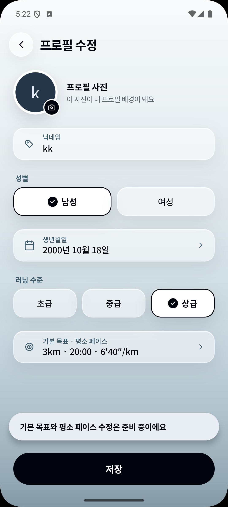

# S01 인증·프로필·설정 — 테스트 보고서

| 항목 | 내용 |
| --- | --- |
| Suite | S01 인증·프로필·설정 |
| 실행일 | 2026-11-07 |
| 환경 | 로컬 BE(`:8080`) · Android 에뮬(`emulator-5554`) · Metro(`:8081`) · W-A/`RFAY31E5QKM` · W-B/`RFAXB285QAE` |
| 계정 | A=`kimgm1018`(닉 `kk`) / 가입·잠금·탈퇴=`qatest` / 알림 API=`qawatchb01`+`qanoti01` |
| 실행자 | 사용자(UI) + AI(알림·공개범위·탈퇴 API) |
| 종합 판정 | Partial |
| 스크린샷 정책 | **불통과 항목만** 첨부. 통과·미실행은 이미지 없음 |

기준 시나리오: `docs/qa/local-integration-test-scenarios.md` §2

---

## TC-S01-01 — B 신규 가입

| 항목 | 내용 |
| --- | --- |
| ID | TC-S01-01 |
| 우선순위 | High |
| 사전조건 | 미사용 loginId `qatest` |
| 절차 | 1. 약관 동의 후 가입 |
| 기대 결과 | 가입 성공, 초기 러닝 프로필 화면 |

### 판정

| 항목 | 내용 |
| --- | --- |
| 결과 | **통과** |
| 불통과 사유 | 해당 없음 |
| 개선점 | 없음 |

---

## TC-S01-02 — 필수 동의 누락

| 항목 | 내용 |
| --- | --- |
| ID | TC-S01-02 |
| 우선순위 | High |
| 사전조건 | - |
| 절차 | 1. 필수 동의 누락 상태로 다음 진행 시도 |
| 기대 결과 | 다음 화면으로 넘어가지 않음 |

### 판정

| 항목 | 내용 |
| --- | --- |
| 결과 | **통과** |
| 불통과 사유 | 해당 없음 |
| 개선점 | 없음 |

---

## TC-S01-03 — 중복 아이디/닉네임

| 항목 | 내용 |
| --- | --- |
| ID | TC-S01-03 |
| 우선순위 | High |
| 사전조건 | 기존 계정 |
| 절차 | 1. 동일 loginId·nickname으로 가입 시도 |
| 기대 결과 | 중복 안내, 가입 실패 |

### 판정

| 항목 | 내용 |
| --- | --- |
| 결과 | **통과** |
| 불통과 사유 | 해당 없음 |
| 개선점 | 없음 |

---

## TC-S01-04 — 로그인 성공

| 항목 | 내용 |
| --- | --- |
| ID | TC-S01-04 |
| 우선순위 | High |
| 사전조건 | 계정 존재 |
| 절차 | 1. 올바른 자격으로 로그인 / 재로그인 |
| 기대 결과 | 홈 진입, 재로그인 성공 |

### 판정

| 항목 | 내용 |
| --- | --- |
| 결과 | **통과** |
| 불통과 사유 | 해당 없음 |
| 개선점 | 없음 |

---

## TC-S01-05 — 로그인 실패·잠금

| 항목 | 내용 |
| --- | --- |
| ID | TC-S01-05 |
| 우선순위 | Med |
| 사전조건 | - |
| 절차 | 1. 연속 로그인 실패 → 앱 종료 후 재시도 |
| 기대 결과 | 10분 잠금 안내, 앱 재시작 후에도 잠금 유지(U01) |

### 판정

| 항목 | 내용 |
| --- | --- |
| 결과 | **통과** |
| 불통과 사유 | 해당 없음 |
| 개선점 | 없음 |

---

## TC-S01-06 — 온보딩 프로필 저장

| 항목 | 내용 |
| --- | --- |
| ID | TC-S01-06 |
| 우선순위 | High |
| 사전조건 | 가입 직후 |
| 절차 | 1. 수준·평소 페이스 저장 |
| 기대 결과 | 홈 이동, 재로그인 시 온보딩 스킵 |

### 판정

| 항목 | 내용 |
| --- | --- |
| 결과 | **통과** |
| 불통과 사유 | 해당 없음 |
| 개선점 | 없음 |

---

## TC-S01-07 — 온보딩 중 종료

| 항목 | 내용 |
| --- | --- |
| ID | TC-S01-07 |
| 우선순위 | Med |
| 사전조건 | 미저장 |
| 절차 | 1. 앱 종료 후 재로그인 |
| 기대 결과 | 다시 온보딩 유도 |

### 판정

| 항목 | 내용 |
| --- | --- |
| 결과 | **Blocked** |
| 불통과 사유 | 해당 없음 |
| 개선점 | AI 주도 범위에서 앱 강제 종료 UI 재현은 사람 확인으로 넘김. API만으로 `onboardingCompleted=false` 유지는 가입 직후 토큰으로 확인 가능하나 “중도 종료” 시나리오와 동일하지 않음 |

---

## TC-S01-08 — 프로필/평소 페이스 수정

| 항목 | 내용 |
| --- | --- |
| ID | TC-S01-08 |
| 우선순위 | Med |
| 사전조건 | 로그인 |
| 절차 | 1. 프로필 수정에서 수준·기본 목표/평소 페이스 변경 |
| 기대 결과 | 값 반영, 세션 목표로 자동 확정되지 않음 |

### 결과 화면

원본: 바탕화면 `qatest_S01_change_mypace.png`

### 판정

| 항목 | 내용 |
| --- | --- |
| 결과 | **불통과** |
| 불통과 사유 | 초급/중급/상급 변경은 가능. **기본 목표·평소 페이스**는 탭 시 「기본 목표와 평소 페이스 수정은 준비 중이에요」만 표시되고 수정 화면으로 진입하지 않음 (`ProfileEditScreen` 의도적 차단) |
| 개선점 | 기본 목표·평소 페이스 수정 UI/API 연동 후 재검증. 당분간 미구현이면 TC 범위를 「러닝 수준만」으로 축소하거나 Blocked 표기 |

---

## TC-S01-09 — 계정 공개/비공개

| 항목 | 내용 |
| --- | --- |
| ID | TC-S01-09 |
| 우선순위 | High |
| 사전조건 | 대상 `qawatchb01`, 타인 `qapriv01`(미팔로우)·`qanoti01`(팔로우) |
| 절차 | 1. U14 `isPrivate` 전환 2. U21으로 타인 프로필 조회 |
| 기대 결과 | 공개=전체 프로필, 비공개+미승인=제한 프로필, 승인 팔로워·본인=전체 |

### 판정

| 항목 | 내용 |
| --- | --- |
| 결과 | **통과** |
| 불통과 사유 | 해당 없음 |
| 개선점 | 없음 |

검증 메모 (API U13/U14/U21, 2026-11-07):

| 설정 | 조회자 | `profileAccessible` | 노출 |
| --- | --- | --- | --- |
| 공개 | 미팔로우 타인 | `true` | `runningLevel`·팔로워수·게시물 목록 포함 |
| 비공개 | 미팔로우 타인 | `false` | `userId`·`nickname`·팔로우상태·프로필사진만 |
| 비공개 | 승인 팔로워 | `true` | 공개와 동일 전체 |
| 비공개 | 본인 | `true` | 전체 (`isFollowing=null`) |

---

## TC-S01-10 — 설정·알림 토글

| 항목 | 내용 |
| --- | --- |
| ID | TC-S01-10 |
| 우선순위 | Med |
| 사전조건 | 로그인 |
| 절차 | 1. U19/U20 알림 on/off 2. 커뮤니티 설정에 따른 알림함 생성 여부 |
| 기대 결과 | 설정 유지, 알림 생성 여부가 설정과 일치 |

### 판정

| 항목 | 내용 |
| --- | --- |
| 결과 | **통과** |
| 불통과 사유 | 해당 없음 |
| 개선점 | `groupRun` 이벤트(취소·시작 임박) 유발 검증은 후속 |

검증 메모: `qawatchb01` 수신 / `qanoti01` 팔로워. 설정 PATCH/GET 왕복 OK. `community=false` 시 팔로우 알림 0건, `true` 시 `NEW_FOLLOWER` 1건.

---

## TC-S01-11 — 로그아웃

| 항목 | 내용 |
| --- | --- |
| ID | TC-S01-11 |
| 우선순위 | High |
| 사전조건 | 로그인 |
| 절차 | 1. 로그아웃 |
| 기대 결과 | 로그인 화면 복귀, 세션 종료 |

### 판정

| 항목 | 내용 |
| --- | --- |
| 결과 | **통과** |
| 불통과 사유 | 해당 없음 |
| 개선점 | 없음 |

---

## TC-S01-12 — 회원 탈퇴

| 항목 | 내용 |
| --- | --- |
| ID | TC-S01-12 |
| 우선순위 | Low |
| 사전조건 | 테스트 계정 `qatest` |
| 절차 | 1. U18 탈퇴(`password`+`agreed=true`) 2. 동일 자격 로그인 |
| 기대 결과 | 재로그인 불가(일반 자격 실패와 동일 401), loginId 재사용 불가 |

### 판정

| 항목 | 내용 |
| --- | --- |
| 결과 | **통과** |
| 불통과 사유 | 해당 없음 |
| 개선점 | 없음 |

검증 메모 (2026-11-07):

- 탈퇴 전 로그인 200
- `DELETE /users/me` → 200, `withdrawnAt=2026-11-07T05:27:39Z`
- DB: id=6 `WITHDRAWN`, nickname=`탈퇴한 회원`
- 재로그인 → 401 `INVALID_CREDENTIALS` / `아이디 또는 비밀번호가 올바르지 않습니다.`
- loginId availability → `available=false`, `DUPLICATED`

---

## 실행 요약

| ID | 결과 | 불통과 사유 | 개선점 |
| --- | --- | --- | --- |
| TC-S01-01 | 통과 | 해당 없음 | 없음 |
| TC-S01-02 | 통과 | 해당 없음 | 없음 |
| TC-S01-03 | 통과 | 해당 없음 | 없음 |
| TC-S01-04 | 통과 | 해당 없음 | 없음 |
| TC-S01-05 | 통과 | 해당 없음 | 없음 |
| TC-S01-06 | 통과 | 해당 없음 | 없음 |
| TC-S01-07 | Blocked | 앱 강제종료는 사람 재현 | 사람 UI 확인 |
| TC-S01-08 | **불통과** | 기본 목표·평소 페이스 수정 불가 | 수정 기능 구현 또는 TC 범위 조정 |
| TC-S01-09 | 통과 | 해당 없음 | 없음 |
| TC-S01-10 | 통과 | 해당 없음 | groupRun 이벤트 후속 |
| TC-S01-11 | 통과 | 해당 없음 | 없음 |
| TC-S01-12 | 통과 | 해당 없음 | 없음 |

### 불통과 스크린샷 목록

| 파일 | TC |
| --- | --- |
| `docs/qa/images/s01/qatest_S01_change_mypace.png` | TC-S01-08 |
