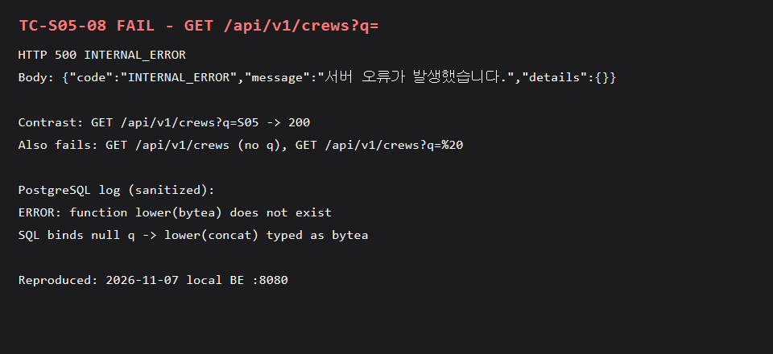

# S05 크루 — 테스트 보고서

| 항목 | 내용 |
| --- | --- |
| Suite | S05 크루 |
| 실행일 | 2026-11-07 |
| 환경 | 로컬 BE(`http://127.0.0.1:8080/api/v1`) · API 주도 |
| 계정 | A=`qahost01`(id=5) / B=`qawatchb01`(id=4) / 거절·정원 보조=`qanoti01`(id=7) |
| 실행자 | AI(API) |
| 종합 판정 | Partial |
| 스크린샷 정책 | **불통과 항목만** 첨부. 통과·미실행은 이미지 없음 |

기준 시나리오: `docs/qa/local-integration-test-scenarios.md` §6  
API 계약: `docs/design/api/crews.md`, `docs/design/api/community.md`(CMT12·CMT13)

사용 크루:

| id | name | 비고 |
| --- | --- | --- |
| 5 | `[QA] S05 crew` | 생성·가입·승인·탈퇴·권한 |
| 6 | `[QA] S05 reject` | 거절 |
| 7 | `[QA] S05 cap1` | capacity=1 정원 마감 |
| 8 | `[QA] S05 dissolve` | 해산 후 INACTIVE |

---

## TC-S05-01 — A 크루 생성

| 항목 | 내용 |
| --- | --- |
| ID | TC-S05-01 |
| 우선순위 | High |
| 사전조건 | A 로그인 |
| 절차 | 1. `POST /crews` 이름·지역·정원 |
| 기대 결과 | 크루 생성, A=owner APPROVED |

### 판정

| 항목 | 내용 |
| --- | --- |
| 결과 | **통과** |
| 불통과 사유 | 해당 없음 |
| 개선점 | 없음 |

검증 메모: crew id=5 `[QA] S05 crew` 생성 **201**, ownerId=5, capacity=10.

---

## TC-S05-02 — 지역 검색(목업) / BE 대리

| 항목 | 내용 |
| --- | --- |
| ID | TC-S05-02 |
| 우선순위 | Med |
| 사전조건 | api 모드. FE 장소 목업은 별도. BE는 `/regions`·`/search` 존재·동작 확인 |
| 절차 | 1. `GET /regions` 2. `GET /search?q=광안리` 및 `q=S05` |
| 기대 결과 | 지역·통합검색 API 응답. 실지도 장소 검색은 FE 목업 범위 |

### 판정

| 항목 | 내용 |
| --- | --- |
| 결과 | **통과** |
| 불통과 사유 | 해당 없음 |
| 개선점 | FE 목업 UI 선택 흐름은 사람 재현. BE `/search`는 러너·크루만(광안리 장소 후보 없음이 정상) |

검증 메모:

- OpenAPI에 `/api/v1/regions`, `/api/v1/search` 존재
- `GET /regions` → **200**, items≈284
- `GET /search?q=광안리` → **200** `{users:[], crews:[]}`
- `GET /search?q=S05` → **200**, crews id 5·6·7 포함

---

## TC-S05-03 — B 가입 신청

| 항목 | 내용 |
| --- | --- |
| ID | TC-S05-03 |
| 우선순위 | High |
| 사전조건 | 승인제 크루(crew5) |
| 절차 | 1. B가 `POST /crews/{id}/join-requests` |
| 기대 결과 | PENDING |

### 판정

| 항목 | 내용 |
| --- | --- |
| 결과 | **통과** |
| 불통과 사유 | 해당 없음 |
| 개선점 | 없음 |

검증 메모: B(id=4) join → **200** `status=PENDING`.

---

## TC-S05-04 — A 승인

| 항목 | 내용 |
| --- | --- |
| ID | TC-S05-04 |
| 우선순위 | High |
| 사전조건 | PENDING 신청 |
| 절차 | 1. A가 `PATCH .../join-requests/{userId}` body `{status:APPROVED}` |
| 기대 결과 | B APPROVED, 멤버 수+1 |

### 판정

| 항목 | 내용 |
| --- | --- |
| 결과 | **통과** |
| 불통과 사유 | 해당 없음 |
| 개선점 | 없음 |

검증 메모: PATCH → **200** APPROVED.

---

## TC-S05-05 — A 거절

| 항목 | 내용 |
| --- | --- |
| ID | TC-S05-05 |
| 우선순위 | Med |
| 사전조건 | PENDING 신청(crew6) |
| 절차 | 1. A가 body `{status:REJECTED}` |
| 기대 결과 | REJECTED |

### 판정

| 항목 | 내용 |
| --- | --- |
| 결과 | **통과** |
| 불통과 사유 | 해당 없음 |
| 개선점 | 없음 |

검증 메모: crew6에서 `qanoti01` → **200** REJECTED.

---

## TC-S05-06 — 정원 마감

| 항목 | 내용 |
| --- | --- |
| ID | TC-S05-06 |
| 우선순위 | Med |
| 사전조건 | crew7 capacity=1(오너만 APPROVED), B PENDING |
| 절차 | 1. A가 B 승인 시도 2. 정원 만원인 상태에서 추가 신청·승인 |
| 기대 결과 | 정원 초과 거부(`409 CREW_CAPACITY_EXCEEDED`) |

### 판정

| 항목 | 내용 |
| --- | --- |
| 결과 | **통과** |
| 불통과 사유 | 해당 없음 |
| 개선점 | 정원 만원이어도 `POST join-requests`는 PENDING 허용(계약 M04). 시나리오 문구의 ‘신청 거부’와는 부분 불일치 — 정책 문서화 또는 신청 단계 가드 검토 |

검증 메모:

- crew7 capacity=1, memberCount=1(오너)
- B 승인 → **409** `CREW_CAPACITY_EXCEEDED` / `크루 정원이 가득 찼습니다.`
- `qanoti01` 신청 → **200** PENDING, 승인 → **409** `CREW_CAPACITY_EXCEEDED`

---

## TC-S05-07 — 비오너 신청 목록

| 항목 | 내용 |
| --- | --- |
| ID | TC-S05-07 |
| 우선순위 | High |
| 사전조건 | B가 비오너 |
| 절차 | 1. B가 `GET /crews/{id}/join-requests` |
| 기대 결과 | 403/권한 없음 |

### 판정

| 항목 | 내용 |
| --- | --- |
| 결과 | **통과** |
| 불통과 사유 | 해당 없음 |
| 개선점 | 없음 |

검증 메모: B → **403** `NOT_ADMIN` / `크루 관리 권한이 없습니다.` (재확인 2026-11-07).

---

## TC-S05-08 — 크루 검색 lower(bytea)

| 항목 | 내용 |
| --- | --- |
| ID | TC-S05-08 |
| 우선순위 | High |
| 사전조건 | 빈 q 또는 q 생략 검색(M01) |
| 절차 | 1. `GET /crews?q=` 2. 대조 `GET /crews?q=S05` |
| 기대 결과 | 200 목록. 빈/생략 q도 전체 ACTIVE 검색 가능 |

### 결과 화면



부가 증거: `docs/qa/images/s05/TC-S05-08-empty-q-500.json`

### 판정

| 항목 | 내용 |
| --- | --- |
| 결과 | **불통과** |
| 불통과 사유 | `GET /crews?q=`·`GET /crews`(q 생략)·`GET /crews?q=%20` 모두 **500** `INTERNAL_ERROR`. PG: `function lower(bytea) does not exist`(null q 바인딩 시 concat→bytea). `GET /crews?q=S05`는 **200** |
| 개선점 | JPQL `lower`/`concat` null 바인딩 분리(빈 검색은 q 조건 생략) 또는 파라미터를 text로 캐스팅. 등급 A(빈 검색·무크루 홈 차단) |

BE 로그 요약(비밀 제외):

```
ERROR: function lower(bytea) does not exist
STATEMENT: select ... from crews c1_0 where c1_0.status=$1
  and ($2 is null or lower(c1_0.name) like lower(('%'||$3||'%')) escape '')
  and ($4 is null or c1_0.region_code=$5) order by c1_0.id
```

---

## TC-S05-09 — 멤버 내보내기/탈퇴

| 항목 | 내용 |
| --- | --- |
| ID | TC-S05-09 |
| 우선순위 | Med |
| 사전조건 | 멤버≥2 이후 B 탈퇴 |
| 절차 | 1. B가 `DELETE /crews/{id}/members/me` |
| 기대 결과 | 상태 LEFT |

### 판정

| 항목 | 내용 |
| --- | --- |
| 결과 | **통과** |
| 불통과 사유 | 해당 없음 |
| 개선점 | 내보내기(M09)는 이번 스위트에서 미실행(탈퇴 경로만 확인) |

검증 메모: B leave crew5 → **200** LEFT. 이후 crew5 memberCount=1.

---

## TC-S05-10 — 크루 해산

| 항목 | 내용 |
| --- | --- |
| ID | TC-S05-10 |
| 우선순위 | Low |
| 사전조건 | owner |
| 절차 | 1. 비오너 해산 시도 2. owner `DELETE /crews/{crewId}` |
| 기대 결과 | `status=INACTIVE`, 검색 미노출 |

### 판정

| 항목 | 내용 |
| --- | --- |
| 결과 | **통과** |
| 불통과 사유 | 해당 없음 |
| 개선점 | 없음 |

검증 메모:

- crew8 `[QA] S05 dissolve` 생성 **201**
- B dissolve → **403** `NOT_ADMIN`
- A dissolve → **200** `{id:8,status:INACTIVE}`
- 상세 조회 시 myMembershipStatus=`LEFT`, memberCount=0
- `GET /crews?q=dissolve` → items=0
- 멱등 재해산 → **200** INACTIVE

---

## 실행 요약

| ID | 결과 | 불통과 사유 | 개선점 |
| --- | --- | --- | --- |
| TC-S05-01 | 통과 | 해당 없음 | 없음 |
| TC-S05-02 | 통과 | 해당 없음 | FE 목업 UI는 사람 재현 |
| TC-S05-03 | 통과 | 해당 없음 | 없음 |
| TC-S05-04 | 통과 | 해당 없음 | 없음 |
| TC-S05-05 | 통과 | 해당 없음 | 없음 |
| TC-S05-06 | 통과 | 해당 없음 | 만원 시 신청(PENDING)은 허용 — 정책 정리 |
| TC-S05-07 | 통과 | 해당 없음 | 없음 |
| TC-S05-08 | **불통과** | 빈/생략 q → 500 `lower(bytea)` | null q 경로 SQL 수정 |
| TC-S05-09 | 통과 | 해당 없음 | 내보내기(M09) 미실행 |
| TC-S05-10 | 통과 | 해당 없음 | 없음 |

### 집계

| 결과 | 개수 |
| --- | --- |
| 통과 | 9 |
| 불통과 | 1 |
| Blocked | 0 |

### 불통과 스크린샷 목록

| 파일 | TC |
| --- | --- |
| `docs/qa/images/s05/TC-S05-08-empty-q-500.png` | TC-S05-08 |
| `docs/qa/images/s05/TC-S05-08-empty-q-500.json` | TC-S05-08(응답·DB 요약) |

### 사람이 재현할 TC

| ID | 이유 |
| --- | --- |
| TC-S05-02 | FE 목업 장소(`광안리` 등) 선택 UI. BE `/regions`·`/search`는 API 확인 완료 |
| TC-S05-08 | 앱 크루 검색 빈어/초기 목록 오류 화면·복구 UX. API·PG `lower(bytea)`는 재현 완료 |
| TC-S05-09 | 내보내기(M09) UI/권한이 필요하면 추가 확인(탈퇴 API만 통과) |
